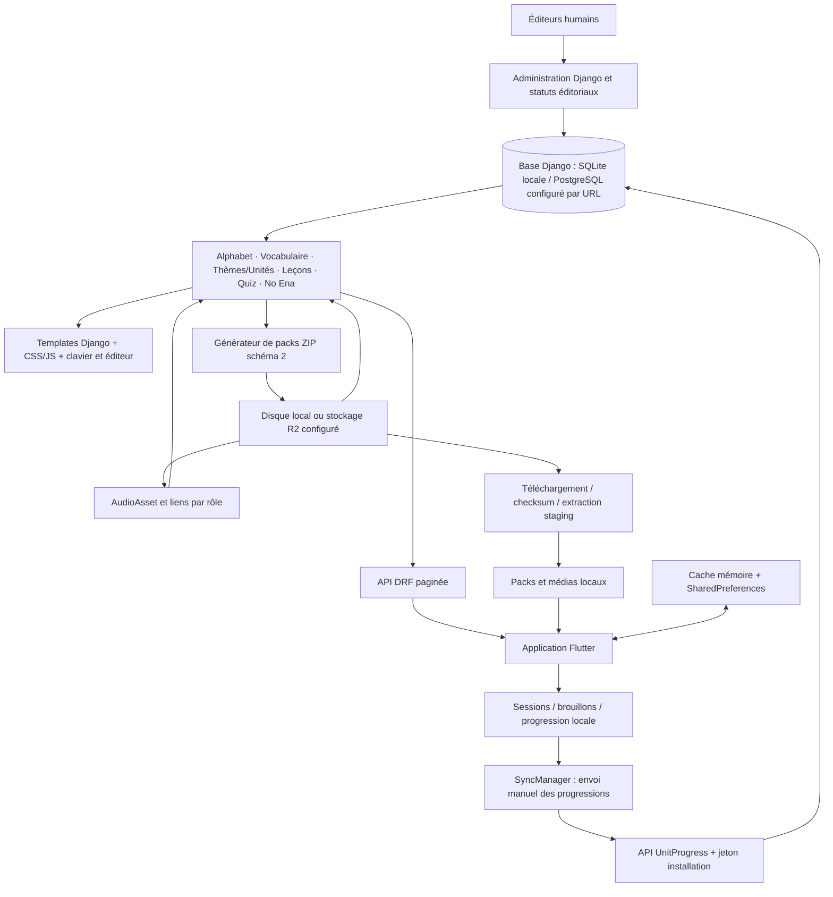

# Audit général BK — 9 novembre 2026

## Décision et périmètre

**Complément après précision pédagogique du propriétaire :** [Audit oralité et audio](AUDIT_ORALITE_2026-11-09.md). Memrise devient l’inspiration pédagogique principale, Duolingo l’appui UX secondaire. Cet approfondissement ajoute N14 (export de leçons bloqué) et N15 (rôle audio des quiz exportés incorrect), reproduits sur données synthétiques ; les suites antérieures réussies ne couvrent pas ces chemins. Il fournit aussi l’inventaire local des droits/métadonnées et de la couverture audio. Aucune correction métier appliquée.

Conserver Django, DRF et Flutter. Une reconstruction ne se justifie pas. La base technique dispose déjà de cache, packs, Unicode, lecteur audio, reprise de session et filtrage éditorial. Les corrections d’octobre sont largement présentes et leurs tests passent, mais la propriété des progressions reste insuffisamment protégée. Traiter ce point avant une remise en service publique.

Audit local du commit `3081aff1b90fade719bc84e22efc1a3dc974523b`. L’inventaire porte sur l’arborescence source entière ; la revue de code et les tests ciblent les parcours et risques décrits ci-dessous. Ce document ne certifie pas une vérification exhaustive de chaque ligne ni de chaque combinaison d’appareil. Le site suspendu, Render, R2, les anciennes archives publiées et les applications distribuées n’ont pas été consultés. Leur état est **impossible à vérifier dans cette session**. L’historique `AUDIT_2026-10-23.md` reste historique : ses défauts ne sont pas automatiquement ceux du commit actuel.

**Preuves :** O = observé dans le code/la copie locale ; T = exécuté en environnement isolé ; H = hypothèse à confirmer ; R = recommandation. « Fonctionne » reste limité au scénario testé. Aucun fichier métier, média, configuration de production ou donnée existante n’a été modifié volontairement. Les nouveaux fichiers sont des livrables et une sonde d’audit dans `docs/`. Les tests produisent leurs fichiers temporaires/cache d’outillage.

L’état Git initial contenait déjà trois `.pyc` modifiés (`offline_packs/admin`, `offline_packs/models`, `progress/models`) et deux JSON non suivis (`audit_checks_results.json`, `audit_inventory_results.json`). Ils n’ont pas été réinterprétés comme résultats du présent audit ni remis à zéro. Aucun `AGENTS.md` n’a été trouvé dans l’inventaire du dépôt. Aucun seed, migration de la copie existante, déploiement ou appel d’écriture distant n’a été exécuté.

## Architecture observée

Le web lit directement l’ORM ; il ne passe pas par son API. Flutter consomme l’API et reconstruit également un flux pédagogique dans `LearningUnitModel` si nécessaire : les deux générateurs de flux demandent des tests de parité. L’export des packs est une troisième représentation. Il n’existe pas de synchronisation générale de toutes les données personnelles : `syncAll()` envoie les progressions.

### Modules et modèles

| Application Django | Responsabilité et entités observées |
|---|---|
| `core` | Permissions de prévisualisation, diagnostic HTTPS staff, commandes bootstrap/seed ; pas de corpus propre |
| `audio_assets` | `AudioAsset`, fichier et validation éditoriale |
| `alphabet` | `Character`, `CharacterAudio`, IPA, transcription, symboles, données de tracé historiques |
| `vocabulary` | `WordCategory`, `Word`, `WordAudio`, traductions FR/EN/AR, exemples, images |
| `learning` | `LearningTheme`, `LearningUnit`, caractères/mots/distracteurs, seuil, flux pédagogique |
| `lessons` | `Lesson`, `LessonItem`, `LessonItemAudio`, liens aux unités |
| `quizzes` | `QuizQuestion`, `QuizOption`, `QuizQuestionAudio` |
| `offline_packs` | `LessonPack`, relations aux objets exportés, version, ZIP, empreinte |
| `progress` | `UnitProgress`, utilisateur/appareil/unité, compteurs, score versionné, jeton |
| `feedback` | `FeedbackReport`, message, capture, référence générique de contenu |
| `no_ena` | `NoEnaPublication`, médias, relations pédagogiques, compteur de vues |
| `webapp` | Vues et templates publics, clavier, éditeur, studio sticker |

Une application Flutter dans `mobile/`, avec scaffolds Android/iOS/web/Windows/Linux/macOS. La présence de ces scaffolds ne prouve pas la compatibilité fonctionnelle : plusieurs services utilisent `dart:io` et des plugins de plateforme. Pas de seconde application mobile distincte identifiée. Le répertoire racine `offline_packs/` contient un autre générateur, différent de celui de `backend/` ; c’est celui sous `backend/` qui est importé dans l’application exécutée. Éviter toute suppression avant recherche des usages externes.

### Contrat des routes

Routes définies par `backend/config/urls.py` et chaque `urls.py` applicatif :

| Préfixe API | Routes relatives |
|---|---|
| `/api/alphabet/` | `characters/`, `characters/<int:pk>/` |
| `/api/vocabulary/` | `categories/`, `words/`, `words/<int:pk>/` |
| `/api/audio/` | racine liste, `<uuid:pk>/` |
| `/api/learning/` | `themes/`, `themes/<int:pk>/`, `units/`, `units/<int:pk>/`, `units/<int:pk>/core-flow/` |
| `/api/lessons/` | racine, `<int:pk>/`, `items/`, `items/<int:pk>/` |
| `/api/quizzes/` | racine, `<int:pk>/` |
| `/api/offline-packs/` | racine, `<int:pk>/` |
| `/api/progress/` | `unit-progress/` GET, `unit-progress/sync/` POST |
| `/api/feedback/` | racine, `create/` POST, `<int:pk>/` |
| `/api/no-ena/` | `publications/`, `publications/<slug>/`, `publications/<slug>/view/` |
| `/api/core/` | `diagnostics/https/` réservé au staff |

Web : `/`, `/alphabet/`, `/vocabulaire/`, `/parcours/`, `/parcours/<slug>/`, `/no-ena/`, `/no-ena/<slug>/`, `/quiz/`, `/feedback/`, `/editeur/`, `/sticker-studio/`, `/download/android/`. Administration sur chemin configurable ; `/admin/` renvoie volontairement 404. Le chemin caché ne remplace pas l’authentification. Les listes DRF utilisent par défaut 50 éléments/page.

### Authentification, données et exploitation

O : utilisateurs et sessions Django standards, permissions staff, DRF sans authentification JWT personnalisée identifiée. Pas d’écran Flutter de création/connexion/récupération de compte dans les routes. L’identité mobile actuelle repose sur UUID + jeton dans SharedPreferences ; ce n’est pas un compte récupérable entre appareils. Ne pas annoncer une synchronisation de comptes mobile déjà opérationnelle.

O : `backend/requirements.txt` épingle Django 6.0.6, DRF 3.17.1 et les dépendances PostgreSQL/R2/WhiteNoise ; `mobile/pubspec.lock` verrouille les paquets Flutter. Dépendances de partage/PDF/impression, HTTP, archive, audio, préférences, connectivité déjà présentes. `pip check` valide leur cohérence déclarée, pas leur absence de CVE. Aucun scan CVE ni vérification en ligne des versions effectué.

O : `build.sh` installe/collecte les statiques ; `release.sh` migre puis bootstrappe un superutilisateur si les variables correspondantes existent. Aucun manifeste Render complet observé : commande de démarrage, disque persistant, sauvegardes distantes, proxy et connexion réelle inconnus. R2 est optionnel dans les réglages. Le fichier `.env.production` a été repéré mais son contenu secret n’a pas été affiché.

O : configuration de sécurité centralisée, validation production et protection release Android présentes. La CI GitHub comporte backend, tests JS, analyse et tests Flutter. Son étape `makemigrations` ne définit pas d’environnement synthétique explicite : vérifier en runner propre, sans conclure à un échec non exécuté. La CI ne construit pas l’APK et n’est pas une recette appareil. Les tarifs de 6,50 + 6,50 USD/mois sont les chiffres communiqués par le propriétaire, soit environ 13 USD/mois hors médias, trafic, domaine, sauvegardes et frais ; aucune facture ni grille commerciale vérifiée.

## Référence exécutée le 9 novembre

| Commande / épreuve | Résultat actuel et limites |
|---|---|
| `backend/venv/Scripts/python.exe docs/run_backend_checks.py` | 59 tests, OK, 14,207 s après relance autorisée ; base mémoire et médias temporaires |
| Première tentative identique dans le bac à sable | 59 exécutés, 4 erreurs `PermissionError` sur médias temporaires, puis nettoyage refusé ; erreur d’environnement, pas une régression métier démontrée |
| `flutter --no-version-check --suppress-analytics test --no-pub` depuis `mobile` | 70 tests, tous réussis, compteur final ~5 s ; première tentative sans sortie interrompue, relance hors bac à sable réussie |
| `flutter --no-version-check --suppress-analytics analyze --no-pub` | Aucune anomalie, 66,6 s |
| `node --test backend/webapp/tests_audio_player.cjs` | 3/3 réussis, processus code 0 |
| `backend/venv/Scripts/python.exe -m pip check` | Aucune incompatibilité déclarée |
| `docs/audit_inventory.py` | SQLite existante ouverte `mode=ro`, intégrité `ok`, 0 violation FK |
| `docs/audit_2026_11_09_probes.py` | Migrations neuves en mémoire exécutées ; `makemigrations --check --dry-run` sans écart ; reproductions et résultats dans `audit_2026_11_09_results.json` |

Les messages ERROR audio/cache dans les tests Flutter correspondent notamment à des pannes simulées ; le verdict de la suite est bien 70 réussites. La sonde d’audit expose des défauts : son code retour 0 ne les transforme pas en comportements acceptables. Les tests d’octobre de cookies, restauration physique et multi-workers n’ont pas été réexécutés ici et restent des preuves historiques seulement.

### Inventaire agrégé de la copie locale

50 caractères ; 4 mots ; 2 thèmes ; 4 unités ; 1 leçon ; 2 questions ; 1 pack ; 1 publication No Ena ; 2 AudioAsset. Parmi les mots, 3 brouillons et 1 publié ; aucune traduction FR/EN/AR vide et aucun groupe de doublons **strictement identiques sur `beriya_text`**. Cela ne recherche pas toutes les variantes Unicode, variantes dialectales ou doublons sémantiques. 49 caractères sans lien audio ; 45 IPA `À_VALIDER`. Aucun des 4 `enable_tracing` activé. 36 migrations enregistrées dans la copie. 36 fichiers sous `backend/media`, total 70 255 384 octets ; ce volume inclut les fichiers présents, pas seulement les médias pédagogiques actifs.

### État fonctionnel

| Fonction | État retenu | Preuve / limite |
|---|---|---|
| Web Django et API publique | Existe et fonctionne dans les scénarios testés | Tests Django + rendu dictionnaire client ; disponibilité distante invérifiée |
| Administration et comptes Django | Existe ; fonctionnement réel des comptes impossible à vérifier | Code auth standard et permissions testées, aucune connexion à un vrai compte |
| Authentification apprenant Flutter | N’existe pas dans les routes inspectées | Identité d’installation seulement |
| Dictionnaire/recherche | Existe, partiel à grande échelle | API paginée et tests pagination ; web non paginé, anomalies N04/N05 |
| Traductions / langue UI | Existe, partiel | FR/EN/AR et RTL prévus ; flux d’exercice encore français |
| Alphabet et typographie | Existe ; Unicode testé, validation linguistique impossible à vérifier | Polices Kedebideri locales, tests UTF-16 ; IPA/audio incomplets |
| Clavier et éditeur Erfe | Existe, partiel vérifié | `Utf16Safe`, tests éditeur, segmentation JS ; geste flottant réel non testé |
| Translittération Erfe–Latin automatique bidirectionnelle | Non identifiée | Champs de transcription et claviers ne prouvent pas un moteur ; aucun aller-retour linguistique annoncé réussi |
| Thèmes, unités, leçons, quiz | Existe et fonctionne dans scénarios automatisés | Reprise et seuil de maîtrise testés ; parité web/mobile incomplète |
| Audio | Existe ; fonctionnement partiel | Lecteurs et sélection testés ; couverture du corpus insuffisante |
| Images | Existe, partiel | Champs, résolveur local et `SmartImage` ; dictionnaire web sans illustration dans son template actuel |
| Packs | Existe et fonctionne dans cas de tests ; accès partiel hors ligne | Générateur, checksum/staging, tests Flutter ; N06/N08 |
| Synchronisation | Présente des erreurs | Envoi des progressions seulement ; N01–N03, N09 |
| Progression / reprise | Existe et fonctionne dans scénarios testés | Session locale versionnée, seuil ; pas de maîtrise certifiée |
| Répétition espacée / file de rappels | N’existe pas dans les modèles/services inspectés | Statut `review` et historique présents, sans échéancier par item |
| Deux parcours distincts complets | N’existe pas comme expérience explicitement séparée | Thèmes/niveaux existants, pas preuve de deux programmes éditoriaux prêts |
| Profil pédagogique complet, XP, badges, objectifs hebdomadaires | Non identifiés | À concevoir, ne pas confondre avec progression unité |
| Tracé manuscrit | Existe mais désactivé dans les données locales | Toujours activable par code/API/administration ; N07 |
| Éditeur/PDF/stickers/No Ena/feedback | Existe ; vérification partielle | Préserver ces fonctions ; tests éditeur, feedback, No Ena et audio ; partage/impression physique non testés |
| Publicité et consentement publicitaire | Non identifiés | Aucun SDK publicitaire dans pubspec ; rien activé |
| Android modeste, iOS, mises à jour installées | Impossible à vérifier | Aucun APK construit/installé ni mesure appareil durant cet audit |

## Anomalies et risques actuels

### N01 — P0 — Revendication des historiques sans preuve

**T**, `backend/progress/views.py`, `UnitProgressListAPIView.get_queryset()` et `UnitProgressSyncAPIView.post()`. Reproduction : créer une progression sans jeton ; GET avec son `device_id` et un jeton arbitraire donne 200/count=1 ; POST avec ce jeton revendique l’enregistrement (`synced_count=1`). La liste globale sans ID est bien bloquée en 403, mais la transition historique reste vulnérable. Cause : un jeton seulement non vide est accepté en absence de jeton enregistré ; attribution au premier demandeur. Connaître l’ID est un prérequis, pas une preuve de propriété. **R :** conserver les historiques en quarantaine logique et récupération contrôlée ; aucune attribution automatique. Valider les règles de récupération avec le propriétaire avant toute évolution.

### N02 — P0 — Jeton contrôlé par unité plutôt que par installation

**T**, même fichier, recherche `(device_id, unit)` puis validation du seul enregistrement. Reproduction : installation avec jeton A sur unité A ; envoyer le même `device_id` et jeton B pour une nouvelle unité B. Accepté. GET avec B retourne les deux historiques (`count=2`) puisque la lecture accepte tout jeton présent dans l’ensemble et filtre ensuite uniquement sur `device_id`. **R :** registre de propriété unique par installation et autorisation commune avant lecture/écriture, transactions/concurrence testées. Migration additive avec conservation des anciens jetons et traitement des ambiguïtés. Ne pas publier de démonstrateur contre le serveur réel.

### N03 — P1 — Jeton mal typé : HTTP 500

**T**, `backend/progress/views.py`, `item_token = (raw.get('device_token') or header_token).strip()`, hors bloc de gestion d’erreur ; absent du sérialiseur d’entrée `backend/progress/serializers.py`. Reproduction POST d’un item valide avec `device_token: 42` : HTTP 500. **R :** champ typé, longueur bornée, validation des en-têtes, erreur 400/par élément. Tester nombres, listes, objets et absence, sans exposer les jetons dans logs/URL.

### N04 — P1 avant croissance — Dictionnaire web non paginé

**O/T**, `backend/webapp/views.py:vocabulary_page`, `backend/templates/webapp/vocabulary.html`. Aucun `Paginator`, toute la sélection rendue. Sonde locale synthétique : 101 mots → 93 956 octets HTML / 7 requêtes / 31,9 ms ; 1 001 → 823 856 octets / 7 requêtes / 69,0 ms. Échantillon unique, cache chaud/froid non contrôlé, sans réseau, images, JavaScript ni mise en page navigateur : ce ne sont pas des temps utilisateur. Le nombre SQL reste stable ; le volume HTML croît. **R :** pagination stable, conservation q/catégorie/langue et mesure navigateur avant/après. Ne pas attribuer toute lenteur Render au seul ORM.

### N05 — P2 — Changer la langue perd les filtres web

**O/T**, `backend/templates/webapp/base.html`, liens `?lang=fr/en/ar`. Reproduction : `/vocabulaire/?q=audit-0001&lang=fr`, cliquer EN → URL sans q, formulaire vidé. Cause : query string reconstruite avec la seule langue. **R :** conserver les paramètres autorisés et tester langue/catégorie/recherche, sans changer les traductions.

### N06 — P1 — Écran catalogue de packs dépendant du réseau

**O**, `mobile/lib/features/offline_packs/screens/offline_packs_screen.dart:_load()`: attend `fetchPacks()` avant `listInstalledPacks()`. Une erreur réseau empêche la lecture de la liste installée dans cet écran. Reproduction à confirmer sur appareil : installer un pack, couper Internet, ouvrir le catalogue ; comparer avec la route distincte `/my-packs`. Les packs ne sont pas forcément perdus ; l’accès dédié existe. **R :** charger les packs locaux indépendamment et conserver cet accès en erreur distante. Test widget catalogue HTTP 503 + pack local.

### N07 — P1 — Interdiction de tracé pas garantie à toutes les entrées

**O/T partiel**, `backend/learning/models.py:generate_core_flow`, migration `0003_learningunit_enable_tracing`, champ admin ; `mobile/lib/features/learning/models/learning_unit_model.dart`, écran `learning_core_unit_screen.dart`, `InteractiveTracingPad`. Valeur false par défaut et 0 unité locale activée, mais true produit une étape `tracing` (couvert par un test existant) et le mobile sait l’afficher. **R :** après validation, rendre ces étapes inaccessibles dans l’expérience autorisée, y compris anciens packs/API ; garder champs/historique pour compatibilité. Aucun nouveau dessin, aucune suppression de données ni extension de cette fonction pendant cet audit.

### N08 — P1 sur appareils modestes — Archive entière en mémoire

**O**, `mobile/lib/features/offline_packs/services/offline_pack_download_service.dart`. `http.get()` puis `response.bodyBytes` et checksum sur l’ensemble. Limites 5 000 entrées/500 Mio décompressés, staging et contrôles de chemins existent déjà : l’ancien constat « aucune protection » est dépassé. En revanche pas de borne téléchargée en flux ni reprise HTTP Range ; checksum facultatif si absent ; validation du manifeste surtout fondée sur sa présence. **H :** risque de pression mémoire/arrêt sur gros pack, non mesuré sur appareil. **R :** téléchargement fichier par blocs, borne compressée, manifeste/relations vérifiés, répertoire de version conservé jusqu’à lecture validée, profil mémoire réel.

### N09 — P1 avant parcours long — Synchronisation non découpée et pas de réception

**O**, `SyncManager.syncAll()`, `UnitProgressSyncService.syncProgressList()`, serveur `MAX_SYNC_ITEMS=100`. La totalité des progressions est envoyée en un POST ; au-delà de 100, le serveur renvoie 400. Reproduction proposée : 101 progressions locales puis synchronisation dans Réglages (non exécutée ici). Aucun téléchargement/fusion de progression distante dans ce service, ni file persistante de travaux/déclenchement général au retour réseau identifiés. Le Learning Core routé ne déclenche pas automatiquement `SyncManager`. **R :** lots ≤100, reprise/idempotence, état en attente et stratégie de fusion formelle ; introduire la réception uniquement avec propriété sécurisée.

### N10 — P1 pédagogique — Couverture audio/validation insuffisante localement

**T lecture seule**, 49/50 caractères sans lien audio, 45 IPA `À_VALIDER`, 3/4 mots brouillons. Une saisie en base ne signifie pas contenu publiable. Reproduction : `docs/audit_inventory.py`, sans afficher de comptes ni modifier le corpus. **R :** tableau éditorial de complétude et validation humaine des sons/textes ; désactiver pédagogiquement les exigences impossibles faute de ressources, sans inventer d’enregistrements ou de traductions. Disponibilité du corpus distant inconnue.

### N11 — P2 — Localisation incomplète au cœur des exercices

**O**, `backend/learning/models.py:generate_core_flow()` génère des consignes françaises et `french_translation` ; `learning_core_unit_screen.dart` affiche `titleFr` et des messages français. Reproduction à confirmer visuellement : langue EN/AR, ouvrir une unité Learning Core. **R :** séparer clés UI et contenu validé, choisir les champs de langue existants, fallback explicite. Aucun texte Beřiya créé automatiquement.

### N12 — P2 — Sonde de disponibilité confond serveur joignable et alphabet non vide

**O**, `mobile/lib/core/network/backend_status_service.dart` et `core/api/backend_health_service.dart`: GET de l’alphabet et `items.isNotEmpty`. Une API 200 vide est considérée hors ligne. Timeout release 900 ms (`AppEnvironment`), cache 20 s ; une connexion lente peut provoquer un repli local malgré un serveur opérationnel. **R :** diagnostic léger et statut HTTP distinct de la disponibilité des contenus, repli local immédiat, mesure connexion lente avant choix des délais.

### N13 — P2 — Duplication de générateur et de logique pédagogique

**O**, générateurs aux racines `offline_packs/services/` et `backend/offline_packs/services/` de SHA différents ; génération du flux dans Python et Dart. Cause probable : reliquat/évolution indépendante, non preuve d’exécution du mauvais fichier. **R :** documenter le chemin canonique, tests de contrat API/pack/mobile ; rechercher usages avant archivage d’un doublon. Aucune suppression proposée automatiquement.

### Points prioritaires sans anomalie démontrée

Doublons exacts : aucun sur les 4 mots locaux ; aucune déduplication automatique. Suppression Erfe : gestion des paires UTF-16 testée, segmentation JS présente ; sélections coupant un caractère, signes combinants, appuis prolongés et clavier flottant restent à vérifier en interaction. Images/audio distants : pas de test HTTP sur CDN. Déconnexions : aucune session réelle ouverte ; pas d’affirmation de correction. Recherche API : filtres présents et pagination mobile testée ; recherche arabe par transcription et normalisation Unicode demandent une règle linguistique validée. Compatibilité PostgreSQL, restore Render et migrations d’une ancienne base peuplée : non exécutés.

Les réponses des quiz sont transmises au client (`correct_index`, `correct_text_answer`, HTML `data-correct`) pour la correction locale. Compatible avec l’apprentissage hors ligne, incompatible avec une certification antifraude ; ne pas ajouter classement compétitif ou récompense financière sur cette base. Les jetons installation sont en clair dans stockage applicatif/préférences et modèles ; évaluer stockage protégé et empreinte serveur avec migration progressive, sans rotation aveugle.

## Pièces complémentaires

- [Parcours et UX/UI](AUDIT_PARCOURS_2026-11-09.md).
- [Concept et maquettes fonctionnelles proposées](CONCEPT_BK_2026-11-09.md).
- [Matrice de priorisation](PRIORITES_BK_2026-11-09.md).
- [Plan de développement par lots](PLAN_BK_2026-11-09.md).
- [Plan de validation et non-régression](VALIDATION_BK_2026-11-09.md).
- [Sonde reproductible](audit_2026_11_09_probes.py) et [résultats mesurés](audit_2026_11_09_results.json).

Les propositions restent à valider. Aucun feu vert de publication n’est donné : il manque notamment propriété des progressions corrigée, recette appareil, preuves de sauvegarde/restauration de production et vérification du contenu publié.
