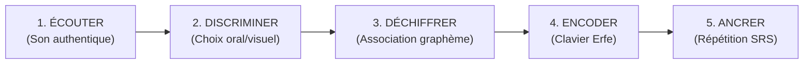
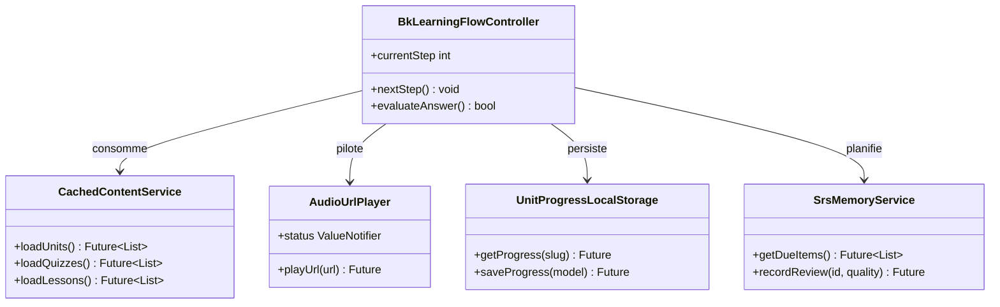
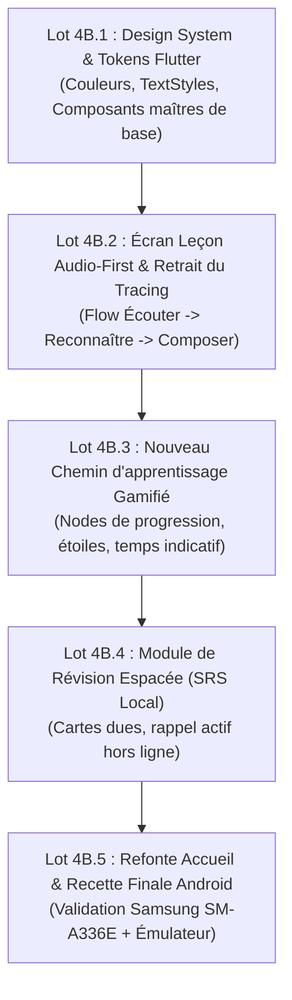

# Beriyar Kedebideri — Phase 4A
# Conception UX/UI Audio-First & Design System

**Date** : 10 novembre 2026  
**Auteurs** : Architecte Flutter/Django, Spécialiste UX/UI Mobile, Ingénieur QA  
**Branche Git dédiée** : `feature/phase4-ux-ui-audio-first` (basée sur le commit `ce4b043`)  
**Statut** : **DOCUMENT DE CONCEPTION ET MAQUETTES — EN ATTENTE DE VALIDATION UTILISATEUR AVANT TOUT DÉVELOPPEMENT**

---

## Sommaire

1. [Rappel du cadrage et engagements préliminaires](#1-rappel-du-cadrage-et-engagements-pr%C3%A9liminaires)
2. [Livrable 1 — Audit UX/UI ciblé des écrans Flutter réels](#2-livrable-1--audit-uxui-cibl%C3%A9-des-%C3%A9crans-flutter-r%C3%A9els)
3. [Livrable 2 — Design System original « Sahel Modern »](#3-livrable-2--design-system-original--sahel-modern-)
4. [Livrable 3 — Maquettes Avant / Après des écrans clés](#4-livrable-3--maquettes-avant--apr%C3%A8s-des-%C3%A9crans-cl%C3%A9s)
5. [Livrable 4 — Parcours interactif du Pilote A (« Je parle Beřiya, j’apprends l’Erfe »)](#5-livrable-4--parcours-interactif-du-pilote-a--je-parle-beriya-japprends-lerfe-)
6. [Livrable 5 — Architecture technique de l’intégration Flutter](#6-livrable-5--architecture-technique-de-lint%C3%A9gration-flutter)
7. [Livrable 6 — Matrice de risques et de non-régression](#7-livrable-6--matrice-de-risques-et-de-non-r%C3%A9gression)
8. [Livrable 7 — Plan de développement par lots (Phase 4B)](#8-livrable-7--plan-de-d%C3%A9veloppement-par-lots-phase-4b)

---

## 1. Rappel du cadrage et engagements préliminaires

Conformément aux instructions strictes de démarrage de la Phase 4A :
1. **État du code figé** : Le commit `ce4b043` (`feat(phase3.1): validation complete Phase 3.1 et correction des 4 anomalies Android`) ancre l'ensemble des correctifs, tests et rapports de validation de la Phase 3.1.
2. **Rapports et preuves Android conservés** : `docs/PHASE3_1_CORRECTIFS_ANDROID.md`, `docs/qa_android/PHASE3_1_RESULTS.json`, `docs/qa_android/phase3_android_test.dart` et les scripts de collecte d'éléments de preuve sont archivés et intègres.
3. **Branche propre** : L'espace de travail est nettoyé (`working tree clean`).
4. **Branche dédiée active** : `feature/phase4-ux-ui-audio-first` a été créée et activée.
5. **Aucune modification en production** : Aucune base de données de production n'est altérée ; aucun écran de production n'est modifié tant que cette conception n'est pas validée.
6. **Exclusion stricte du dessin manuscrit** : Le composant `tracing` (dessin tactile au doigt sur canevas) est définitivement banni de la progression pédagogique, au profit de l'écoute, de la reconnaissance et de l'encodage au clavier Erfe.
7. **Intégrité linguistique absolue** : Aucun caractère Erfe, mot ou son n'est inventé artificiellement. Seules les données validées du corpus sont exploitées.

---

## 2. Livrable 1 — Audit UX/UI ciblé des écrans Flutter réels

### 2.1 Analyse critique de l'existant

L'examen approfondi du code Flutter (`mobile/lib/features/`) et les tests sur Samsung SM-A336E ont mis en évidence les constats ergonomiques suivants :

```
┌─────────────────────────────────────────────────────────────────────────────┐
│                            CONSTATS AUDIT UX/UI                             │
├───────────────────────────────┬─────────────────────────────────────────────┤
│ Écran actuel                  │ Faiblesses identifiées & Dettes UX          │
├───────────────────────────────┼─────────────────────────────────────────────┤
│ 1. Accueil (home_screen.dart) │ • Surcharge de cartes « GlassCard » uniformes│
│                               │ • Éparpillement : 7 boutons d'action égaux │
│                               │ • Manque d'appel à l'action unique (CTA)    │
│                               │ • Pas de jauge de progression quotidienne   │
│                               │ • Mode hors ligne perçu comme une erreur   │
├───────────────────────────────┼─────────────────────────────────────────────┤
│ 2. Parcours                   │ • Liste plate de blocs sans gamification    │
│    (learning_path_screen.dart)│ • Absence de métaphore visuelle (chemin)    │
│                               │ • Statuts (verrouillé, en cours, réussi)    │
│                               │   visuellement peu différenciés             │
│                               │ • Pas d'estimation claire de temps (3-5 min)│
├───────────────────────────────┼─────────────────────────────────────────────┤
│ 3. Leçon                      │ • Présence du composant « tracing » tactile │
│    (learning_core_unit_screen)│   frustrant et non pédagogique              │
│                               │ • Trop orienté texte d'abord, audio second  │
│                               │ • Glisser-déposer syllabique trop compact   │
│                               │ • Bouton « Suivant » parfois hors écran     │
├───────────────────────────────┼─────────────────────────────────────────────┤
│ 4. Clavier Erfe               │ • Touches trop denses sur petits écrans     │
│    (beriya_keyboard.dart)     │ • Pas d'animation de frappe (haptique/son)  │
│                               │ • Clavier masquant parfois le champ de saisie│
├───────────────────────────────┼─────────────────────────────────────────────┤
│ 5. Révision / SRS             │ • Aucun écran dédié aux révisions espacées  │
│                               │ • L'utilisateur ne sait pas quoi réviser    │
│                               │ • Tout repose sur le rejeu manuel complet   │
└───────────────────────────────┴─────────────────────────────────────────────┘
```

### 2.2 Composants réutilisables identifiés et préservés

Pour garantir une refonte **non destructive** et pérenne, les briques logiques et services éprouvés lors des Phases 1, 2, 3 et 3.1 sont intégralement réutilisés sans rupture de contrat :

1. **Services de données et cache** :
   - `CachedContentService` : Fournisseur unique de données (online, offlinePack, localCache, memoryCache).
   - `OnlineContentCacheService` : Persistance clé-valeur avec déduplication intégrée.
   - `LocalPackReaderService` & `OfflineContentService` : Résolution des packs décompressés.
   - `UnitProgressLocalStorage` : Source de vérité locale des scores, étapes et états de complétion.
2. **Audio & Multimédia** :
   - `AudioUrlPlayer` : Lecteur avec états observables (`playing`, `loading`, `idle`, `failed`), contrôle des fichiers 0 octet et gestion des coupures.
3. **Saisie et Clavier Erfe** :
   - `BeriyaKeyboard` : Clavier virtuel Unicode avec layout phonétique et touches natives.
   - `BeriyaTextField` & `Utf16Safe` : Gestion sécurisée des points de code Unicode Erfe (plan SMP `U+16EA0`–`U+16EDF`).
4. **Tokens graphiques de base** :
   - `AppTokens` : Palette officielle (`brandDark`, `brandNight`, `brandGreen`, `brandGold`), espacements et cibles tactiles WCAG 48px.
   - Police vectorielle `Kedebideri` : Rendu officiel des glyphes Erfe.

---

## 3. Livrable 2 — Design System original « Sahel Modern »

Le Design System de Beriyar Kedebideri ne copie pas servilement Duolingo ou Memrise ; il synthétise la clarté motivante de Duolingo et la primauté orale de Memrise dans une identité visuelle sahélienne moderne et sobre.

### 3.1 Principes directeurs

1. **Audio-First (L'oreille avant l'œil)** : Tout apprentissage commence par une écoute claire. Le bouton audio est le centre de gravité visuel de chaque étape.
2. **Élévation et contraste chaleureux** : Fond nocturne profond (`#061A14`), surfaces vert acacia (`#0F3227`), accents or sahélien (`#D4AF37`) pour célébrer l'accomplissement et l'action prioritaire.
3. **Respect sacré de l'écriture Erfe** : Taille minimale de 44px pour les glyphes individuels, 26px pour les mots, avec interlettrage généreux empêchant tout chevauchement des diacritiques.
4. **Bienveillance sans anxiété** : Pas de système de « vies perdues » bloquantes, pas de timer punitif, pas de pénalité de série si l'utilisateur est hors ligne. La progression valorise l'effort.
5. **Cibles tactiles accessibles** : Tout bouton ou zone d'interaction mesure au minimum **48x48 dp** (conformité WCAG 2.5.5).

### 3.2 Palette chromatique sémantique

```
┌─────────────────────────────────────────────────────────────────────────────┐
│                        PALETTE « SAHEL MODERN »                             │
├─────────────────┬───────────┬───────────────────────────────────────────────┤
│ Rôle            │ Code Hex  │ Usage & Sémantique                            │
├─────────────────┼───────────┼───────────────────────────────────────────────┤
│ Night Background│ #061A14   │ Fond principal de l'application               │
│ Surface Dark    │ #0B251D   │ Cartes, panneaux et fiches d'exercices        │
│ Surface Light   │ #133D30   │ Cartes interactives actives, conteneurs audio │
│ Acacia Green    │ #1B4D3E   │ Couleur de structure et d'élévation secondaire│
│ Sahel Gold      │ #D4AF37   │ Boutons d'action primaire (CTA), étoiles, XP  │
│ Gold Glow       │ #F3E5AB   │ Reflets, surbrillances et focus               │
│ Pure White      │ #FFFFFF   │ Texte principal, contrasté > 12:1 sur fond     │
│ Muted Sahara    │ #C2CDBE   │ Textes secondaires, consignes et métadonnées  │
│ Success Emerald │ #2E7D32   │ Validation positive, bordures de succès       │
│ Encouragement   │ #D97706   │ Réponse incomplète, invitation à réécouter    │
│ Neutral Border  │ #244A3E   │ Délimitation nette des cartes sans flou       │
└─────────────────┴───────────┴───────────────────────────────────────────────┘
```

### 3.3 Typographie et Lisibilité Erfe

| Style de texte | Police | Taille | Graisse | Usage spécifique |
|---|---|---|---|---|
| **Erfe Display Hero** | `Kedebideri` | **52 sp** | Bold | Présentation d'un caractère isolé en phase découverte |
| **Erfe Word Title** | `Kedebideri` | **34 sp** | Bold | Mots cibles dans les exercices et le dictionnaire |
| **Erfe Option Text** | `Kedebideri` | **26 sp** | Semi-Bold | Touches du clavier et cartes de choix multiples |
| **Latin Heading** | Système (Inter/Roboto) | **22 sp** | Bold | Titres d'unités, en-têtes d'écrans |
| **Latin Instruction** | Système | **16 sp** | Medium | Consignes orales et consignes pédagogiques |
| **Latin Caption** | Système | **13 sp** | Regular | Durée, badges hors ligne, statistiques SRS |

### 3.4 Composants maîtres réutilisables

1. **`BkAudioHeroButton`** :
   - Grand bouton circulaire (diamètre 84 dp) orné d'une onde sonore animée.
   - Trois modes d'écoute : Vitesse normale (1.0x), Vitesse lente décomposée (0.75x via appui long ou bouton secondaire dédié), et répétition illimitée.
2. **`BkLearningNode` (Chemin d'apprentissage)** :
   - Nœud circulaire flottant représentant chaque leçon avec anneau de complétion (0%, 50%, 100%).
   - 4 états visuels distincts : Verrouillé (cadenas sobre), Actuel (halo pulsant or), Réussi (icône étoile or), À réviser (anneau ambré avec badge SRS).
3. **`BkOptionCard`** :
   - Carte de sélection haute (hauteur min 64 dp) avec retour tactile instantané, bordure réactive (or au focus, vert émeraude si correct, ambre si encouragement).
4. **`BkFeedbackSheet`** :
   - Feuille basse modale s'ouvrant instantanément lors de la validation :
     - **Succès** : Fond vert émeraude adouci, icône de fête discrète, mot d'encouragement en Beřiya et français, bouton CTA « Continuer ».
     - **Erreur/Encouragement** : Fond terre cuite ambrée, bouton « Réécouter » proéminent, explication du son contrastif, bouton « J'ai compris ».
5. **`BkErfeKeycap`** :
   - Touche de clavier individuelle profilée (hauteur 52 dp), caractère Erfe centré à 24 sp, retour haptique doux (vibration 10 ms).

---

## 4. Livrable 3 — Maquettes Avant / Après des écrans clés

### Écran 1 : Accueil / Tableau de bord

````carousel
```text
=== AVANT (Phase 3.1) ===
[ En-tête : Logo BK + Déconnexion ]
-----------------------------------------
[ Carte Glass : Titre « Beriyar Kedebideri » ]
[ Carte Connexion : Mode en ligne / hors ligne ]
[ Carte Progrès : « Dernière unité consultée : 1 » ]
-----------------------------------------
[ Bouton : « Commencer l'apprentissage » ]
[ Bouton : « Alphabet » ]
[ Bouton : « Vocabulaire » ]
[ Bouton : « No Ena » ]
[ Bouton : « Mes téléchargements » ]
[ Bouton : « Paramètres » ]
-----------------------------------------
Constat : Liste de boutons sans hiérarchie.
Aucun encouragement visuel quotidien.
```
<!-- slide -->
```text
=== APRÈS (Phase 4A « Sahel Modern ») ===
[ En-tête : Flamme Série 🔥 5 jours | Étoiles ⭐ 140 | Pack Hors Ligne 🟢 ]
--------------------------------------------------------------------------
┌────────────────────────────────────────────────────────────────────────┐
│  🎯 OBJECTIF DU JOUR : 1 séance (3 min)                                │
│  ██████████████████░░░░  2 / 3 étapes                                   │
└────────────────────────────────────────────────────────────────────────┘
--------------------------------------------------------------------------
┌────────────────────────────────────────────────────────────────────────┐
│  📍 REPRENDRE MON PARCOURS                                             │
│  Unité 1 : Les sons d'attaque [b] et [e]                               │
│                                                                        │
│  [  ▶  CONTINUER LA LEÇON (3 MIN)  ]  (Bouton Or proéminent 56dp)      │
└────────────────────────────────────────────────────────────────────────┘
--------------------------------------------------------------------------
┌───────────────────────────┐ ┌──────────────────────────────────────────┐
│ 🔄 RÉVISION ESPACÉE       │ │ 📚 DICTIONNAIRE PARLÉ                    │
│ 4 sons à réactiver        │ │ 12 mots avec audio authentique           │
│ [ Réviser maintenant ]    │ │ [ Explorer ]                             │
└───────────────────────────┘ └──────────────────────────────────────────┘
--------------------------------------------------------------------------
[ Navigation basse permanente : Accueil 🏠 · Parcours 🗺️ · Réviser 🔄 · Profil 👤 ]
```
````

---

### Écran 2 : Parcours d'apprentissage (« Le Chemin Erfe »)

````carousel
```text
=== AVANT (Phase 3.1) ===
[ AppBar : Parcours d'apprentissage + Icône Pack ]
[ Carte Méthode Active V1 ]
- Thème 1 : Les bases
  - Unité 1 (Bouton Ouvrir)
  - Unité 2 (Bouton Ouvrir)
- Thème 2 : La vie quotidienne
  - Unité 3 (Bouton Ouvrir)
-----------------------------------------
Constat : Formulaire vertical plat.
Pas de sentiment de voyage ou de progression.
```
<!-- slide -->
```text
=== APRÈS (Phase 4A « Sahel Modern ») ===
[ AppBar : Thème 1 — L'éveil des sons (A1.1)            ⭐ 140 XP ]
------------------------------------------------------------------
                 ┌──────────────────────────┐
                 │    ( ⭐ Étoile Or )      │  <- Leçon 1 : Terminée
                 │   Unité 1 : Le son /b/   │     (Score 100%)
                 └─────────────┬────────────┘
                               │ (Ligne dorée pleine)
                 ┌─────────────┴────────────┐
                 │    ( 🎧 Halo Pulsant )   │  <- Leçon 2 : EN COURS
                 │   Unité 2 : Le son /e/   │     « 3 min restantes »
                 │  [ ▶ DÉMARRER ]          │     (Bouton flottant)
                 └─────────────┬────────────┘
                               │ (Ligne pointillée verte)
                 ┌─────────────┴────────────┐
                 │    ( 🔒 Cadenas sobre )  │  <- Leçon 3 : Verrouillée
                 │   Unité 3 : Syllabe «be» │     (Débloquée après Leçon 2)
                 └─────────────┬────────────┘
                               │
                 ┌─────────────┴────────────┐
                 │    ( 🏆 Trophée Thème )  │  <- Épreuve de consolidation
                 │   Grand Quiz Thème 1     │
                 └──────────────────────────┘
```
````

---

### Écran 3 : Séance d'apprentissage Audio-First

````carousel
```text
=== AVANT (Phase 3.1) ===
[ Barre de progression 2/6 ]
[ Carte avec petit texte « Écouter » ]
[ Bouton de lecture standard ]
[ Canevas de tracé tactile au doigt (dessin) ]
[ Bouton Valider ]
-----------------------------------------
Constat : Le tracé au doigt prenait tout l'écran,
plantait sur émulateur et n'enseignait pas l'écriture.
```
<!-- slide -->
```text
=== APRÈS (Phase 4A « Sahel Modern ») ===
[ X Quitter                     Étape 2 / 5                 Score : 100% ]
[ ████████████████░░░░░░░░░░░░░░░░░░░░░░░░░░░░░░░░░░░░░░░░░░░░░░░░░░░░░ ]
--------------------------------------------------------------------------
          🎧 ÉCOUTE ATTENTIVEMENT LE SON :

                 ┌─────────────────────────┐
                 │          (( 🔊 ))       │
                 │   [ BkAudioHeroButton ] │  <- Grand bouton central or
                 │   Lecture automatique   │     Ondes sonores animées
                 └─────────────────────────┘
                    [ 🐢 Écoute lente ]

         « Quel caractère correspond à ce son ? »
--------------------------------------------------------------------------
     ┌───────────────────────┐       ┌───────────────────────┐
     │          𖺡           │       │          𖺣           │
     │      (/b/ - Erfe)     │       │      (/e/ - Erfe)     │
     │     [Carte Choix A]   │       │     [Carte Choix B]   │
     └───────────────────────┘       └───────────────────────┘
--------------------------------------------------------------------------
┌────────────────────────────────────────────────────────────────────────┐
│  Feuille basse instantanée :                                           │
│  ✨ « Bravo ! C'est bien le caractère 𖺡 correspondant au son /b/. »    │
│  [ ▶ CONTINUER ]                                                      │
└────────────────────────────────────────────────────────────────────────┘
```
````

---

### Écran 4 : Composition et Encodage au Clavier Erfe

````carousel
```text
=== AVANT (Phase 3.1) ===
[ Champ texte minuscule ]
[ Clavier virtuel brut occupant 60% de l'écran ]
[ Touches trop rapprochées, sans accentuation ]
[ Aucune assistance auditive de touche ]
```
<!-- slide -->
```text
=== APRÈS (Phase 4A « Sahel Modern ») ===
[ X                             Étape 4 / 5                       🔊 Réécouter ]
--------------------------------------------------------------------------
          🎧 Écris le mot entendu en Beřiya :

                       « be »  (/be/)
                  ┌───────────────────────┐
                  │       𖺡  𖺣           │  <- Zone de saisie contrastée
                  │    [ Curseur doré ]   │     Caractères 36sp nets
                  └───────────────────────┘
--------------------------------------------------------------------------
  Clavier Erfe contextuel (Touches 52dp, retour haptique doux) :
  ┌─────┬─────┬─────┬─────┬─────┬─────┬─────┬─────┐
  │ 𖺠   │ 𖺡   │ 𖺢   │ 𖺣   │ 𖺤   │ 𖺥   │ 𖺦   │ 𖺧   │
  ├─────┼─────┼─────┼─────┼─────┼─────┼─────┼─────┤
  │ 𖺨   │ 𖺩   │ 𖺪   │ 𖺫   │ 𖺬   │ 𖺭   │ 𖺮   │ 𖺯   │
  ├─────┼─────┼─────┼─────┴─────┴─────┼─────┼─────┤
  │ 𖺰   │ 𖺱   │ 𖺲   │   ESPACE (𖺵)    │ ⌫   │ 🔊  │
  └─────┴─────┴─────┴─────────────────┴─────┴─────┘
--------------------------------------------------------------------------
[ Bouton plein Or : « VÉRIFIER MA SAISIE » (56dp) ]
```
````

---

## 5. Livrable 4 — Parcours interactif du Pilote A (« Je parle Beřiya, j’apprends l’Erfe »)

Le Pilote A s'adresse spécifiquement à la personne qui **possède déjà l'usage oral de la langue Beřiya** et dont l'objectif est d'apprendre à lire et à écrire son alphabet propre, l'**Erfe**.

### 5.1 Les 5 étapes pédagogiques d'une séance (3 à 5 minutes)



1. **Étape 1 — ÉCOUTER (Immersion orale)** :
   - Le son authentique est joué automatiquement dès l'ouverture de l'écran.
   - Grand bouton `BkAudioHeroButton` avec ondes animées.
   - Bouton « Écoute ralentie » pour bien percevoir les détails articulatoires.
2. **Étape 2 — DISCRIMINER (Reconnaissance audio -> caractère)** :
   - L'utilisateur écoute le son cible sans voir d'écriture latine.
   - 2 ou 3 cartes de choix Erfe sont proposées avec des contrastes phonétiques et visuels nets.
   - Sélection tactile avec validation immédiate.
3. **Étape 3 — DÉCHIFFRER (Lecture active & Fusion syllabique)** :
   - Révélation du caractère en grand format (`52 sp`) avec sa transcription latine d'appui discrète.
   - Réécoute simultanée du nom du caractère et de sa valeur phonétique.
4. **Étape 4 — ENCODER (Composition active au clavier Erfe)** :
   - Écoute du mot ou de la syllabe (`/be/`).
   - L'apprenant tape sur le clavier Erfe les deux touches correspondantes (`𖺡` puis `𖺣`).
   - Chaque appui émet un micro-clic sonore pour confirmer la frappe.
5. **Étape 5 — ANCRER (Consolidation et planification SRS)** :
   - Récapitulatif instantané des 4 à 5 éléments abordés pendant la séance.
   - Attribution des XP et mise à jour de la mémoire espacée locale.

---

## 6. Livrable 5 — Architecture technique de l’intégration Flutter

### 6.1 Conservation intégrale des contrats de données

L'intégration se fait sans aucune modification de la base SQLite ni des endpoints d'API :



### 6.2 Modèle local de Répétition Espacée (SRS Local-First)

Pour respecter la contrainte d'absence de serveur lourd et de fonctionnement hors ligne total :
- Un service léger `SrsLocalStorage` stocke dans `SharedPreferences` les cartes mémoire d'apprentissage sous forme de liste JSON :
  ```json
  {
    "element_id": "char_1",
    "erfe_glyph": "𖺠",
    "sound_key": "arkap.wav",
    "repetitions": 3,
    "interval_days": 4,
    "ease_factor": 2.5,
    "next_review_at": "2026-11-14T08:00:00Z"
  }
  ```
- Algorithme SM-2 simplifié :
  - Réponse correcte immédiate : intervalle x 2.2.
  - Réponse hésitante (après réécoute) : intervalle maintenu.
  - Erreur : intervalle remis à 1 jour.
- Fonctionnement 100% autonome hors ligne.

---

## 7. Livrable 6 — Matrice de risques et de non-régression

| Risque identifié | Niveau | Mesure préventive architecturale |
|---|---|---|
| **Régression audio hors ligne** | Élevé | Utilisation stricte de `AudioUrlPlayer` et `_resolveAudioUri` validés en Phase 3.1. Aucun bypass direct. |
| **Chevauchement des caractères Erfe** | Modéré | Définition d'un `letterSpacing` de 1.5 dp et d'une hauteur de ligne `1.2` sur `TextStyle` pour la police `Kedebideri`. |
| **Lenteur sur terminaux d'entrée de gamme** | Modéré | Pas de shaders complexes ni de flous gaussiens temps réel superposés ; utilisation de conteneurs semi-transparents légers. |
| **Incohérence des scores** | Élevé | Réutilisation de la formule unique validée `correctDisplayIndex = optionOrder.indexOf(correctIndex)`. |
| **Conflit de synchronisation réseau** | Faible | Conservation du protocole `UnitProgressLocalStorage` et de la migration 0004 garantissant la préservation du meilleur score. |

---

## 8. Livrable 7 — Plan de développement par lots (Phase 4B)

Le développement futur de la Phase 4B sera découpé en 5 lots incrémentaux, vérifiés chacun sur émulateur et sur le Samsung réel :



- **Lot 4B.1** : Implémentation des tokens `BkTheme`, `BkAudioHeroButton`, `BkOptionCard` et `BkFeedbackSheet` dans `mobile/lib/core/theme/` et `widgets/`.
- **Lot 4B.2** : Refonte de `LearningCoreUnitScreen` : suppression définitive du step `tracing`, introduction de l'auto-play audio et du feedback unifié.
- **Lot 4B.3** : Remplacement de la liste de thèmes par le composant `BkLearningPath` avec nœuds animés et jauges de progression.
- **Lot 4B.4** : Création du contrôleur `SrsMemoryService` et de l'écran dédié `/reviews` avec calcul d'échéances locales.
- **Lot 4B.5** : Modernisation du tableau de bord d'accueil, tests de non-régression complets et recette physique sur Samsung SM-A336E.

---

**FIN DU RAPPORT DE CONCEPTION PHASE 4A**  
*Ce document et les maquettes associées attendent la validation formelle de l'utilisateur avant le lancement du Lot 4B.1.*
