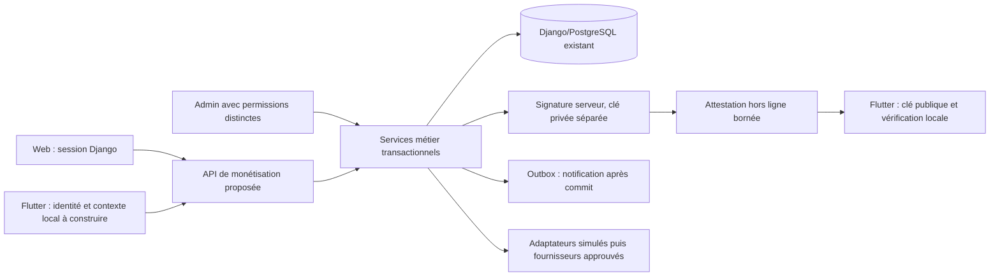

# Phase 6.4A — Architecture de monétisation proposée

10 novembre 2026. Base Git **77ff698**, branche
`codex/phase6-4-monetisation-design`. **Conception à approuver, aucune implémentation.**
Les blocages de production de Phase 6.3 restent ouverts. Aucun montant, compte de
paiement, SDK publicitaire, migration ou abonnement n’a été créé.

## Les dix livrables

| # | Livrable | Document |
|---|---|---|
| 1 | Architecture, inventaire, API et compatibilité | Ce document |
| 2 | Schéma et modèles Django proposés | [MODELES_DJANGO_PROPOSES.md](phase6_4/MODELES_DJANGO_PROPOSES.md) |
| 3 | Matrice Free/Premium | [MATRICE_FREE_PREMIUM.md](phase6_4/MATRICE_FREE_PREMIUM.md) |
| 4 | Formats et catégories publicitaires | [MATRICE_PUBLICITES.md](phase6_4/MATRICE_PUBLICITES.md) |
| 5 | Droits Premium hors ligne | [DROITS_HORS_LIGNE.md](phase6_4/DROITS_HORS_LIGNE.md) |
| 6 | Paiements et activations manuelles | [WORKFLOW_PAIEMENTS_MANUELS.md](phase6_4/WORKFLOW_PAIEMENTS_MANUELS.md) |
| 7 | Permissions administratives | [PERMISSIONS_ADMIN.md](phase6_4/PERMISSIONS_ADMIN.md) |
| 8 | Conformité et fournisseurs | [CONFORMITE_PLATEFORMES_FOURNISSEURS.md](phase6_4/CONFORMITE_PLATEFORMES_FOURNISSEURS.md) |
| 9 | Développement progressif | [PLAN_DEVELOPPEMENT.md](phase6_4/PLAN_DEVELOPPEMENT.md) |
| 10 | Risques, tests et rollback | [RISQUES_TESTS_ROLLBACK.md](phase6_4/RISQUES_TESTS_ROLLBACK.md) |

## Inventaire ciblé de l’existant

Lecture du code et recherche de références, **pas validation fonctionnelle** :

| Composant observé | Preuve locale | Réutilisation / limite |
|---|---|---|
| Utilisateurs Django et permissions | `backend/config/settings.py`, FKs `settings.AUTH_USER_MODEL` dans progress/feedback/No Ena | Utiliser le même utilisateur, pas un compte Premium parallèle ; aucun AUTH_USER_MODEL personnalisé trouvé |
| Authentification serveur | DRF sans remplacement des classes d’authentification par défaut ; Admin Django | Sessions et Basic existants ; aucune connexion native de compte identifiée dans Flutter |
| Propriété compte/invité | `progress/ownership.py`, `ProgressDeviceCredential`, `UnitProgress` | Frontières serveur à conserver ; jeton invité **non valable comme identité de paiement** |
| Identité mobile actuelle | `core/device/device_id_service.dart` | UUID et secret d’installation dans SharedPreferences ; pas une clé de signature ni une identité de bénéficiaire |
| Réseau Flutter | `core/api/api_client.dart`, `api_config.dart` | Réutiliser limites d’origine, timeouts et erreurs ; ajouter un contexte d’authentification après validation, sans changer implicitement les appels de progression |
| Persistance pédagogique | `unit_progress_local_storage.dart` : préfixe `bk_unit_progress_`, historique par slug | Pas de cloisonnement par compte observé ; obstacle à l’introduction sûre du login/changement A/B |
| Packs | `offline_packs/models.py`, download service Flutter | SHA-256, chemins et extraction existants à préserver ; URLs actuelles publiques, pas des téléchargements Premium protégés |
| Médias privés | `core/media_storage.py`, `feedback/private_media.py` | Réutiliser le backend privé et les validateurs ; **ne pas réutiliser les URLs/permissions feedback** pour reçus ou ressources commerciales |
| Roles existants | `core/permissions.py`, `progress/views.py` | Certains accès utilisent staff, progress exige aussi une permission ; monétisation exigera des permissions métier distinctes |
| SDK et modules commerciaux | Recherche modèles, settings, urls, pubspec et services | Aucun module paiement/don/abonnement/AdMob/AdSense ou SDK d’achat identifié |
| « premium » dans Sticker Studio | `StickerStyleType.premium`, `sticker_studio_screen.dart` | Style graphique existant, **pas un abonnement** ; reste gratuit |

Les `StreamSubscription` du lecteur audio ne sont pas des abonnements commerciaux.
L’absence d’une référence dans cette recherche n’est pas une preuve d’absence dans
un service externe non connecté. Aucun compte marchand, console Ads, statut fiscal,
pays d’établissement ou contrat opérateur BK n’a été vérifié.

## Choix d’architecture recommandés

1. Un module Django `monetization` proposé, indépendant des fournisseurs. Services
   métier uniques pour calculer les droits, rapprocher les encaissements et décider
   d’une exposition publicitaire. Admin, API et futures tâches appellent ces services.
2. Réutiliser PostgreSQL, permissions Django, sessions, stockage privé et cache
   partagé préparés en Phase 6.3. Pas de Redis/Celery/microservice obligatoire.
   Notifications par outbox et commande périodique future ; aucun envoi dans cette phase.
3. **Identité avant commerce mobile** : même utilisateur Django, sessions web
   existantes. Proposition mobile : session Django via transport TLS, stockage
   sécurisé du secret de session et CSRF conservé ; pas de mot de passe mémorisé
   ni nouveau JWT propriétaire. Cette proposition requiert un lot d’authentification
   et d’isolation locale distinct, absent aujourd’hui.
4. Le consentement, l’âge/audience, les exclusions pédagogiques et les droits
   sont vérifiés avant toute initialisation/requête Ads. Tout est désactivé par défaut.
5. Les prestations existantes gratuites ne deviennent pas payantes par un simple
   changement Admin. Les avantages proposés restent des options à choisir humainement.
6. Les droits hors ligne sont des attestations asymétriques limitées, jamais un
   booléen local ou un HMAC vérifiable en embarquant le secret Django.

### Contrat d’identité à approuver avant les droits payants

L’API dérive toujours le bénéficiaire de `request.user`. Un `user_id`, un email,
un reçu, un `device_id` ou `X-Device-Token` transmis par le client ne l’authentifie pas.
L’invité conserve tout l’apprentissage gratuit ; l’acquisition/restauration de droits
personnels exige une connexion de compte préalablement vérifiée.

Le futur transport de session doit traiter rotation à la connexion, expiration,
logout côté serveur, CSRF sur login et mutations, limitation des tentatives,
récupération de compte et refus de redirection vers une autre origine. Les
permissions Basic existantes ne sont pas supprimées globalement ; stocker les
identifiants Basic en permanence sur le téléphone n’est pas recommandé.

Ajouter un login ne doit pas attacher silencieusement la progression invitée au
compte : le code actuel sait rattacher un historique lors d’une sync authentifiée.
Le lot identité doit donc définir les contextes guest/A/B pour progression, SRS,
historique et droits, avec copie/migration explicite et idempotente des historiques
autorisés. Pas de suppression des anciennes clés SharedPreferences. Ne pas injecter
automatiquement des cookies dans le service de synchronisation avant ce travail.

## Endpoints proposés — aucun n’existe encore

Préfixe versionné `/api/monetization/v1/`. Authentification/permissions explicites
sur chaque vue : le `AllowAny` global actuel ne doit pas s’y appliquer par oubli.

| Méthode / route | Accès et réponse minimale |
|---|---|
| `GET public-config/` | Public ; version, dates, flags publics, emplacements autorisés et politique de canal ; zéro secret/PII ; pas d’offres actives par défaut |
| `GET catalog/` | Offres et tarifs publiés après filtrage pays/canal/devise ; aucun montant codé dans Flutter ; absent ≠ prix nul |
| `GET me/entitlements/` | Compte authentifié uniquement, droits recalculés ; pas de paramètre de bénéficiaire ; `private,no-store` |
| `POST me/device-keys/challenge/`, `POST me/device-keys/` | Connexion, nonce court, preuve de clé ; aucun rattachement implicite des progressions |
| `POST me/offline-lease/` | Compte et appareil enregistrés, nonce et preuve de possession ; attestation signée ou refus sans perte locale |
| `POST me/requests/` | Déclaration achat/don autorisée pour ce canal, devis serveur et clé d’idempotence ; aucun auto-grant |
| `GET me/requests/`, `GET me/requests/<uuid>/` | Strictement le propriétaire ; réponse générique 404 pour objet tiers |
| `POST me/requests/<uuid>/evidence/` | Propriétaire, pièces privées validées et bornées ; pas de lien d’accès public |
| `GET me/notifications/` | Boîte de notification personnelle ; pas de marketing forcé |
| `POST provider-events/<provider>/` | Seulement ultérieurement : signature fournisseur vérifiée, environnement/compte marchand, anti-rejeu ; pas une API utilisateur |

Les décisions financières et grants passent d’abord par des actions Admin dédiées,
pas par un ModelViewSet CRUD public sur les statuts. Erreurs prévues : 401/403 selon
le mécanisme d’authentification choisi, 404 d’isolation, 409 conflit d’idempotence,
422 état métier incompatible ou 400 validation selon convention DRF retenue,
429 quotas et 503 indisponibilité. Ne pas interpréter 503 comme absence de droit.

`public-config` et `catalog` sont séparés : aucun droit personnel dans une réponse
CDN partagée. Pays/canal fournis par le client ne constituent pas une preuve de
transaction ni un droit à un tarif. La politique commerciale valide une offre et
fige son prix/devise/canal avant toute déclaration ; un callback UI « success »
n’accorde rien. Le filtrage d’interface ne remplace jamais la vérification serveur.

## Migrations, compatibilité et périmètre initial

Proposer seulement des migrations additives de nouvelles tables/FK vers
`settings.AUTH_USER_MODEL`, avec dépendance swappable. Ne pas remplacer le modèle
utilisateur, ni ajouter de flags payants aux tables linguistiques, progressions
ou packs existants. Seed limité aux fonctionnalités gratuites protégées et flags
désactivés ; pas de prix, bénéficiaire bancaire ou abonnement actif par défaut.

Les anciennes API, URLs publiques, ZIP, checksums et clients continuent de fonctionner.
Les premières variantes Premium recommandées évitent les fichiers protégés :
absence de publicité éventuelle et avantages **nouveaux** approuvés. Un futur pack
payant exigerait une livraison privée nouvelle, pas un `is_premium` dans l’UI sur
un fichier déjà public. Chantier différé, incompatible avec une simple réutilisation
de la liste de packs actuelle ; voir matrice Free/Premium.

## Décisions encore nécessaires

- Avantages réellement retenus et garantie du périmètre gratuit ; aucun prix choisi.
- Statut/pays du porteur, encaissements et obligations de justificatifs ; aucun
  « don fiscal » ou éligibilité marchand présumé.
- Fenêtre hors ligne proposée, contrainte après reboot et nombre d’appareils.
- Règles de double contrôle des encaissements, coordonnées et grants administratifs.
- Canal initial recommandé : site web et simulations ; Android direct APK ensuite.
  Google Play/App Store seulement après revue de leurs règles et des builds concernés.

## État de validation de cette conception

**Observé** : inventaire ciblé ci-dessus, Git propre au départ sur 77ff698.
**Proposé** : tous les modèles, routes, écrans et services commerciaux des dix documents.
**Non exécuté** : tests des droits, paiements, annonces, crypto interlangage,
migrations, Android, fournisseurs, déploiement. Les 117/130/5 et l’analyse Flutter
sont les résultats historiques validés de Phase 6.3, pas de nouveaux tests de 6.4A.
Seule la cohérence documentaire et l’absence de changement métier sont vérifiées
ici. La conception ne lève aucun blocage opérationnel précédent.

Les contrôles documentaires exécutés (dix fichiers UTF-8, liens locaux, blocs de
code fermés, empreintes SHA-256 et absence de modification des fichiers suivis de
la référence) sont consignés dans
[VERIFICATION_DOCUMENTAIRE.json](phase6_4/VERIFICATION_DOCUMENTAIRE.json).
Ils ne valident ni le rendu graphique Mermaid ni les futurs services commerciaux.

**Recommandation : valider l’architecture et les décisions ouvertes avant un seul
lot d’implémentation. NO-GO pour activation commerciale ou développement massif.**
