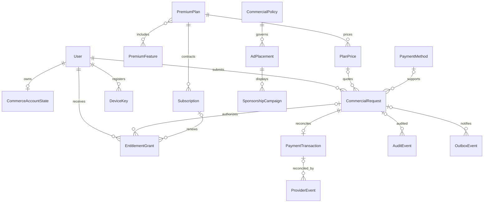

# Modèles Django proposés — livrable 2

Schéma conceptuel, **aucune classe ni migration générée**. Les modèles sont répartis
sur plusieurs lots, pas créés tous ensemble. Réutiliser utilisateurs, sessions,
permissions, PostgreSQL, cache partagé et backend de stockage privé existants.

`User` désigne `settings.AUTH_USER_MODEL` existant. AuditEvent couvre aussi la
configuration, les droits et leurs mutations ; les FK « sujet/action » du schéma
sont simplifiées. Les relations facultatives dépendent du type de demande : un don
ne possède pas de PlanPrice/Grant, une bourse n’a pas de PaymentTransaction.

| Modèle | Champs et règles structurants |
|---|---|
| `CommercialPolicy` | Singleton imposé en DB, version, état draft/approved, flags globaux et web/Android/iOS, fournisseurs/formats autorisés, plafonds, kill switch, audience/consentement, validité de config, policy_version par canal. Tout désactivé ; scripts/secrets exclus |
| `AdPlacement` | Code + plateforme uniques, fournisseur connu, format, identifiant d’emplacement **public**, fréquence plafonnée, enabled=False. Validation d’une liste blanche d’écrans ; exclusions pédagogiques non annulables par Admin |
| `PremiumFeature` | Code stable unique, libellés FR/EN/AR, description, `always_free` protégé. Les codes de fonctions fondamentales sont une invariant côté service/client, pas un simple booléen librement éditable |
| `PremiumPlan` | Code/version, fonctions, période et durée, état draft/approved/retired, dates de commercialisation ; révision immuable dès utilisation. Arrêter de vendre ≠ révoquer les droits déjà acquis |
| `PlanPrice` | Plan/version, pays ISO ou règle internationale explicite, canal, devise validée, montant en unités mineures, période effective, ordre/priorité. Interdire chevauchement ambigu de deux prix actifs équivalents |
| `CommerceAccountState` | OneToOne User, UUID commercial stable non séquentiel, `entitlement_epoch` croissant, statut. Pas de copie de mot de passe/email ; ne remplace pas le compte Django |
| `PaymentMethod` | Type banque/mobile money/espèces/provider/store, pays, devise, bénéficiaire organisationnel et coordonnées publiques nécessaires, instructions FR/EN/AR, canaux, ordre, état draft/approved/inactive. Pas de PIN, mot de passe bancaire ni secret PSP |
| `CommercialRequest` | UUID, bénéficiaire, purpose immuable `purchase/donation/complimentary/scholarship`, statut, devis/prix figés le cas échéant, référence déclarée **non vérifiée**, pièces privées, dates, maker/verifier/approver, motif, clé d’idempotence + empreinte de requête |
| `PaymentTransaction` | Encaissement **vérifié**, fournisseur/environnement/compte marchand/référence canonique, montant/devise, dates, état reçu/remboursé/litigieux, demande affectée. Unicité de référence dans le vrai namespace de l’opérateur, jamais seulement par utilisateur |
| `Subscription` | Contrat utilisateur/plan, origine manual/store/provider, périodes début/fin, statut, arrêt de renouvellement. Ne vaut pas preuve d’encaissement ni de droit à lui seul |
| `EntitlementGrant` | UUID, utilisateur, plan/révision et snapshot des fonctions, source achat/geste/bourse, référence décision/transaction, intervalle UTC, état actif/révoqué/remboursé, acteur et motif. Aucune source donation ; octroi atomique et idempotent |
| `DeviceKey` | Utilisateur, UUID d’enregistrement, empreinte et clé publique, algorithme autorisé, environnement, dates, revoked_at. Le device_id existant peut servir de corrélation, pas de preuve ni de propriétaire |
| `AuditEvent` | Acteur/principal de service, action, sujet opaque, horodatage, correlation_id, différence de champs autorisés et motif. Append-only applicatif ; pas de preuve bancaire complète ou token dans le journal |
| `OutboxEvent` | Événement unique de décision, destinataire, type de notification, payload minimal, tentatives et date prochaine. Créé dans la transaction, notification après commit et dédupliquée |
| `SponsorshipCampaign` — différé | Créatif validé, droits/dates, lien autorisé, indication « Publicité/Partenaire », placement et état approuvé. Médias validés via composants existants ; aucun HTML/JS arbitraire |
| `ProviderEvent` — différé | Fournisseur, environnement, compte marchand, event_id unique, résultat de vérification, état traité/erreur et références. Payload brut seulement privé et à rétention limitée ; jamais une autorité si non vérifié |

### Contraintes financières et cohérence

- Montants entiers en unités mineures (BigInteger avec bornes interopérables),
  jamais `float`. Conversion décimale selon une table de devises validée ; zéro,
  fraction impossible, valeur négative, devise inactive et débordement sont traités
  explicitement. Aucun tarif n’est choisi ici. Un prix absent n’est pas un prix zéro.
- Clés uniques : idempotence `(user, operation, key)` avec même empreinte de corps ;
  transaction vérifiée `(provider, environment, merchant, receipt_namespace, ref)` ;
  octroi `(source_decision, feature_or_grant_slot)` ; événement fournisseur et outbox.
- Les références reçues du déclarant ne sont pas rendues uniques avant vérification :
  un attaquant ne doit pas réserver le reçu d’un autre payeur par une fausse déclaration.
- L’achat référence un devis serveur figé ; le don n’a ni plan ni grant ; le geste
  commercial et la bourse n’inventent aucun paiement. Réception partielle/excédentaire
  reste à rapprocher humainement dans la version initiale, sans auto-activation.
- Dates `[starts_at, ends_at)` en UTC. `ends_at=None` seulement pour un droit permanent
  explicitement approuvé ; l’attestation hors ligne reste toujours limitée.
- Les droits effectifs sont l’union des grants valides non révoqués. Rembourser un
  paiement retire ses seuls grants ; ne pas annuler une bourse indépendante.
- Les plans/prix et coordonnées approuvés se révisent par nouvelles versions ;
  un changement Admin n’altère pas rétroactivement le montant ou contrat accepté.

### Migrations proposées

Nouvelles tables additives seulement, FK swappable vers l’utilisateur ; `PROTECT`
sur plans/prix/transactions référencés plutôt que cascade financière. Suppression
de compte : processus explicite d’anonymisation selon conservation légale, pas
d’effacement en cascade de l’audit ou de conservation indéfinie par défaut.

Chaque lot crée son sous-ensemble, avec contraintes/index et tests sur PostgreSQL
isolé. Les seeds ne créent que codes fondamentaux gratuits et configuration coupée.
La clé privée de signature, les secrets fournisseurs et reçus complets ne sont
pas des fixtures. Ancien code/ancien client avec schéma étendu à vérifier ; ne pas
supposer que toute migration additive rend automatiquement un rollback sûr.

Le registre de clés `DeviceKey` est un justificatif cryptographique commercial,
pas un second mécanisme de propriété des progressions. Ne pas y déplacer ni y
réinterpréter `ProgressDeviceCredential`, ses secrets ou les historiques invités.
