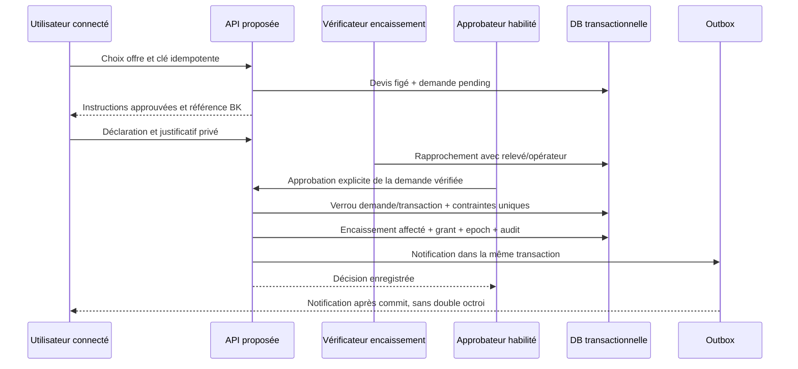

# Paiements et activations manuelles — livrable 6

**Workflow proposé, aucun encaissement ni notification effectué.** Commencer par
des demandes fictives et un adaptateur simulé. Aucun pays, opérateur, compte
bancaire, tarif ou statut de donation fiscale BK n’est présumé.

## Quatre finalités séparées

| Finalité | Flux financier | Droit éventuel |
|---|---|---|
| Achat Premium | Demande avec devis serveur, encaissement rapproché | Grant conforme à l’offre approuvée après décision autorisée |
| Don/contribution sans contrepartie numérique | Encaissement et reçu de contribution si autorisé juridiquement | **Aucun Premium, badge numérique vendu ou contenu débloqué automatiquement** |
| Geste commercial | Pas de transaction fictive | Grant avec motif, durée et approbation de privilège |
| Bourse/accès gratuit | Pas de paiement déclaré | Grant selon décision administrative tracée, sans dette utilisateur |

Dans `CommercialRequest`, purpose est immuable et les contraintes distinguent
montant/devise/devis des demandes gratuites. Le mot « espèces » ne dispense pas
des règles des boutiques pour un avantage numérique. Un code saisi dans une app
Store ne constitue pas automatiquement une exception autorisée.

## Administration des coordonnées

`PaymentMethod` contient pays, devise, type, banque/opérateur, bénéficiaire officiel,
coordonnées **destinées au payeur**, instructions FR/EN/AR, état et ordre. IBAN ou
numéro professionnel de réception peuvent être publics si nécessaires et validés ;
PIN, accès au compte, mots de passe, API secrets et coordonnées carte client ne le
sont jamais. Les coordonnées sensibles privées d’un utilisateur ne sont pas dans
`public-config`.

Publication par version approuvée, contrôle des liens et échappement HTML. Une
modification de bénéficiaire/QR/coordonnées est une opération à risque de fraude :
double contrôle recommandé, aperçu et journal, possibilité de désactiver la méthode.
Pas de substitution rétroactive dans les instructions figées d’une demande passée.
Les moyens non disponibles pour le pays/canal restent invisibles et inactifs.

## Séquence d’un achat manuel

Statuts : `draft → submitted → under_review → verified → approved`, ou `rejected`,
`cancelled`. `submitted/verified` ne débloquent rien. Après approbation,
remboursement/révocation sont des événements distincts, pas une réécriture cachée
du paiement. Annuler une demande non payée et annuler un renouvellement sont aussi
deux opérations différentes.

Le vérificateur consulte un relevé ou l’opérateur indépendant du justificatif
fourni. Une capture peut être fausse ; un numéro de reçu deviné n’attribue pas un
encaissement. Associer payeur, bénéficiaire, montant, devise, méthode, date et
référence. Les cas partiels/excédentaires ou ambigus restent en revue, pas convertis
automatiquement ni abandonnés.

## Concurrence, idempotence et fraude

- En transaction, `select_for_update` sur demande/affectation/état de droits et
  contrainte unique sur la référence **vérifiée** dans son namespace marchand.
  Unicité du grant issu de la décision. Reprendre proprement après IntegrityError.
- Deux approbateurs simultanés produisent un seul octroi ; relancer la même action
  retourne le résultat existant. Même clé d’idempotence avec un autre corps : 409.
- Ne pas rendre unique la référence seulement déclarée avant rapprochement : une
  fausse déclaration ne doit pas empêcher le vrai bénéficiaire de réclamer le reçu.
- Référence sans information de namespace suffisante : contrôle humain, pas de
  concaténation opportuniste avec une date client pour contourner l’unicité.
- Le bénéficiaire d’une demande approuvée ne change pas. Correction d’attribution :
  procédure nouvelle avec motifs, révocation/octroi ciblés et contrôle séparé.
- Refuser l’auto-approbation de sa propre demande/avantage. Séparer vérification et
  approbation recommandé ; règles de cumul de rôles à valider pour la petite équipe,
  jamais une permission implicite accordée à tout `is_staff`.

## Justificatifs et notifications

Nouveaux fichiers privés dans un préfixe commercial distinct, avec valideurs 6.3,
taille/format bornés. Réutiliser `private_backend`, pas les objets FeedbackReport ni
leurs endpoints staff globaux. Le propriétaire voit seulement ses demandes et,
selon besoin, ses propres pièces ; les autres comptes/invités sont refusés. Finance
voit les seuls objets relevant de sa permission/scope. URLs anonymes interdites.

Éviter PDF actif comme justificatif initial : images bornées ou référence suffisent
souvent. Si PDF requis plus tard, traitement isolé et stratégie de validation à
approuver. Pas de PAN/CVV, mot de passe bancaire ou pièce d’identité non nécessaire.
Définir rétention, anonymisation, accès et suppression selon les obligations réelles,
sans promettre « immuable » et « suppression totale immédiate » simultanément.

Outbox transactionnelle, notification in-app en premier ; email éventuel si déjà
configuré et approuvé, sans relevé complet ou secret. Un échec de notification
n’annule pas le grant et une relance ne le recrée pas. La décision est consultable
dans l’espace du compte. Aucun message n’est envoyé par cette étude.

## Renouvellements et fournisseurs futurs

Chaque période exige une preuve nouvelle ou une décision gratuite explicite.
Extension depuis `max(now, fin_actuelle)` pour le même avantage, selon règle approuvée,
sans doubler aveuglément une période active. Dates de souscription Store font foi
après vérification fournisseur. Remboursement de A ne révoque pas un autre grant B.

Webhooks ultérieurs : corps brut borné, signature selon documentation du fournisseur,
date, environnement et compte marchand vérifiés ; event_id dédupliqué et état
autoritatif réconcilié en cas d’événements inversés. Le retour navigateur n’est
pas une preuve. Adaptateur simulé d’abord, aucun endpoint réel configuré.
[Webhooks Stripe](https://docs.stripe.com/webhooks),
[idempotence fournisseur](https://docs.stripe.com/api/idempotent_requests).
