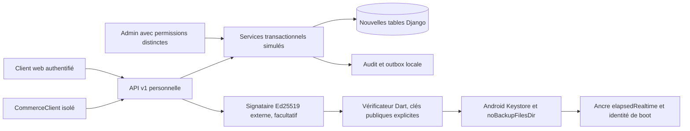

# Architecture réellement implémentée — 6.4B

Socle de **simulation**, sans intégration aux écrans éducatifs ni fournisseur.
Le module Django unique `monetization` réutilise l'utilisateur Django, permissions,
sessions/Basic DRF et transactions existants. Aucune table pédagogique modifiée.

## Treize modèles, deux migrations additives

| Modèle | Fonction implémentée |
|---|---|
| CommercialPolicy | Singleton, version, flags coupés par contrainte SQL, arrêt d'urgence, web/Android, fréquence, catégories souhaitées, durée 1–7 jours |
| PremiumFeature | Liste limitée aux avantages de simulation `simulation.badge` / `ads_free` ; aucun code éducatif existant vendable |
| PremiumPlan | Révision, durée, fonctions, disponibilité explicite en simulation ; caractéristiques figées dans Admin après utilisation |
| CommerceAccountState | Même compte Django, subject opaque, epoch, age_band unknown/minor/adult |
| PaymentMethod | Banque/mobile money/espèces/online futurs, pays ZZ/devise XXX, seules instructions et bénéficiaire littéraux SIMULATION ONLY ; désactivé initialement |
| CommercialRequest | But achat/don/geste/bourse, snapshot, statut, acteur maker/verifier/approver, idempotence et empreinte |
| PaymentTransaction | Référence SIM-* vérifiée et unique dans l'espace de simulation, devise XXX, montant fictif ; aucune preuve réelle |
| EntitlementGrant | Propriétaire, demande unique, snapshot fonctions, intervalle et révocation |
| AdPlacement | Web/Android, format connu, contexte autorisé home/culture_list, fréquence et état initial désactivé |
| AuditEvent | Acteur, action, cible et motif ; lecture seule Admin |
| OutboxEvent | Une notification locale d'activation par demande, enregistrée atomiquement ; aucun envoi |
| DeviceKey | Clé publique P-256 et propriétaire, empreinte et révocation ; pas un secret de progression |
| DeviceChallenge | Nonce temporaire à usage unique par compte et finalité |

Le schéma cible de 6.4A était volontairement plus large.
La migration initiale crée ces 13 modèles et leurs contraintes ; la seconde
autorise un snapshot vide pour un don sans avantage (validation d'état, sans SQL
destructeur). `AUTH_USER_MODEL` est une dépendance swappable. Toutes les FK
métier pointent vers ces nouvelles tables ou le compte existant.

Les prix réels, Subscription auto-renouvelable, SponsorshipCampaign, ProviderEvent
et justificatifs restent différés : pas de pays marchand, d'avantages commercialisés
ou de fournisseur approuvés. Les dates de fin sont celles des grants simulés,
pas des promesses d'abonnement renouvelable. Les dons ne créent jamais de grants ;
gestes/bourses n'inventent pas de transaction.

## Compatibilité gratuite

Le serveur et le vérificateur Dart ont une liste de fonctions existantes toujours
gratuites : alphabet, dictionnaire, initiation, audio, progression, packs, SRS,
clavier, translittération, éditeur et exports. Cette liste ne devient pas un filtre
nouveau sur les anciens endpoints/widgets : **aucun paywall branché à l'existant**.
Le style historique `StickerStyleType.premium` n'est pas associé aux grants.
Pas de contenu linguistique, police, pack, checksum ou règle pédagogique changés.

Les anciens clients ignorent le nouveau préfixe API. Rien n'ajoute de cookie ou
de compte à leur synchronisation. Les nouvelles clés d'appareil sont séparées
de ProgressDeviceCredential et de ses preuves invitées. Les caches pédagogiques
existants ne sont ni migrés ni renommés : le nouveau stockage ne contient que
les attestations commerciales, sous compte/appareil/environnement.

## Hors ligne réel du composant

Signatures serveur Ed25519 ; preuve de possession Android P-256 ; cache AES-GCM
lié au scope par AAD, clés AndroidKeyStore non exportées à Dart, fichiers dans
`noBackupFilesDir`, écriture AtomicFile. Pas de nouvelle dépendance de stockage
sécurisé, de Redis, Celery, reconnaissance vocale ou SDK Ads/Billing.
`cryptography==50.0.2` côté Python et `cryptography 2.9.0` résolu côté Dart sont
les seules nouvelles bibliothèques crypto. `integration_test` et ses dépendances
sont réservés au développement. La taille/coût runtime n'est pas benchmarké ici.

L'ancre native survit à un arrêt de l'app sur le même boot. Après reboot,
réinstallation, perte de clé/ancre ou incohérence : vérification réseau requise
pour les seuls avantages supplémentaires. Les avantages ne reposent jamais sur
un booléen SharedPreferences ou l'heure civile. Le gratuit reste accessible.
Les API Android antérieures à 23 ou sans identité de boot lisible échouent fermées
pour les seuls avantages ; aucune élévation du minSdk existant.

Une app rootée/modifiée peut ignorer son propre vérificateur ; restaurer un ancien
blob complet avec accès privilégié n'est pas une protection anti-rollback absolue.
Révocation et suppression de compte ne peuvent pas être immédiates hors ligne :
borne maximale 7 jours, prochaine réponse authentifiée faisant autorité.

## Limites d'intégration assumées

Le contrôleur et les API sont utilisables en recette ; **aucun parcours de login
mobile ou écran Premium n'est ajouté**. L'appelant doit fournir une session active
et CSRF, restaurer son contexte commercial de façon sûre et appeler logout lors
d'un changement de compte. La preuve de clé est obligatoire pour un lease.
La migration guest/A/B des anciens caches pédagogiques n'est pas effectuée.
Brancher ultérieurement une session globale sur la sync actuelle sans ce chantier
serait dangereux. Le déploiement/intégration commerciale réelle reste bloqué.

L'Admin est configurable mais aucun drapeau ne peut rendre la publicité réelle
ou les ventes actives dans ce lot : contraintes SQL + réponses effectives fermées,
aucun adaptateur. Le signataire est facultatif et non provisionné localement ;
les clés des tests sont temporaires ou publiquement identifiées RFC8032.
Le vérificateur n'accepte pas de clé test en production/release.
