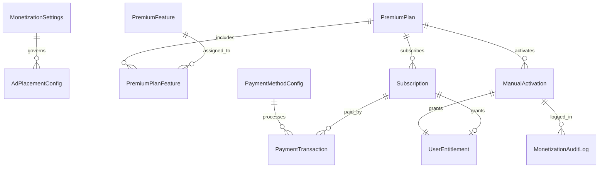

# BERIYAR KEDEBIDERI — PHASE 6
## Audit global Erfe, monétisation administrable et préparation à la production

**Date de l'audit** : 10 novembre 2026  
**Branche auditée** : `feature/phase4-ux-ui-audio-first` (commit de référence `0005693`)  
**Périmètre** : Backend Django, site web public, Django Admin, application mobile Flutter Android, packs hors ligne et infrastructure de déploiement.  
**Statut d'intervention** : **Audit, preuves de reproduction et conception uniquement (aucune modification métier, aucune migration destructive, aucune activation de publicité ou de paiement réel).**

---

## LIVRABLE 1 — RAPPORT D'AUDIT GLOBAL (CHANTIER B : FLUTTER & DJANGO)

### 1.1 Synthèse de conformité des acquis (Phases 1 à 5.1)

L'inspection du code source et de la base locale (`backend/db.sqlite3`, ouverte en lecture seule `?mode=ro`, SHA-256 `0e92a4da3cd7736a6cc9d47f1d770efaf9586774ab3873aadec6eda54c76360b`) confirme que les fondations corrigées lors des Phases 1 à 5.1 sont **solides et intègres** :

- **Propriété des progressions et séparation compte / invité / admin (`backend/progress/ownership.py`, `backend/progress/views.py`)** :
  - `guest_progress_queryset()` exige simultanément `device_id` et `X-Device-Token`, compare le condensat SHA-256 en temps constant (`constant_time_compare`), interdit toute lecture anonyme globale (`403`) et empêche un jeton invité d'accéder à une progression rattachée à un compte (`account_bound=True` ou `user__isnull=False`).
  - `progress_for_sync()` verrouille les enregistrements sous `transaction.atomic()` avec `select_for_update()`, applique une fusion monotone des compteurs (`max(...)`) et vérifie le seuil `min_score_to_pass`.
- **Séparation contenu publié / brouillon (`backend/core/permissions.py`)** :
  - `is_staff_preview(request)` exige explicitement `user.is_authenticated`, `user.is_staff` **et** `?preview=1` (ou `X-Staff-Preview: 1`). Sans ce paramètre explicite, même un administrateur connecté reçoit le comportement public (`status='published'` / `validation_status='published'`).
- **Générateur de packs hors ligne (`backend/offline_packs/services/offline_pack_generator.py`)** :
  - `OfflinePackGenerator` (schéma v2) embarque et réécrit récursivement les médias du `core_flow` (`_rewrite_and_embed_core_flow`), filtre les entités non publiées lorsque `pack.status == 'published'` et calcule le `sha256` et `file_size` de l'archive ZIP.
- **Garde-fous de sécurité serveur et release mobile (`backend/config/security.py`, `mobile/android/app/build.gradle.kts`, `mobile/lib/core/config/app_environment.dart`)** :
  - Validation stricte de `SECRET_KEY` (entropie, longueur $\ge 50$, refus des valeurs connues), `ALLOWED_HOSTS`, `CSRF_TRUSTED_ORIGINS`, `TRUST_X_FORWARDED_PROTO` et `NUM_PROXIES` en production.
  - Côté Android, `usesCleartextTraffic="false"` sur le manifeste principal (`mobile/android/app/src/main/AndroidManifest.xml`) et blocage Gradle + runtime de toute URL locale ou HTTP en mode `release`.

---

### 1.2 Anomalies identifiées et classées par criticité

#### A. Anomalies BLOQUANTES (à corriger impérativement avant mise en production)

| ID | Domaine | Fichiers & Lignes | Description et cause racine | Correction durable prévue |
| :--- | :--- | :--- | :--- | :--- |
| **BLOC-01 (`ERFE-WEB-01..03`)** | Typographie Erfe Web | `backend/static/webapp/css/brand.css` (L1-8, L86), `learning_path.html` (L72-73), `unit_detail.html` (L28, L38, L192, L215, L225, L346), `quiz.html` (L73, L114, L141), `no_ena_detail.html` (L166) | **Rendu en rectangles (`□`) des caractères Erfe dans les titres et textes mixtes du site web** (dont *« Unité 2 : La consonne Te (𖺵) et le mot "ta" »* et *« Unité 3 : La consonne De (𖺢) et le mot "de" »*). `body` et les titres `h1..h3` utilisent `Inter, system-ui, ...` sans fallback `Kedebideri` ni balisage des séquences Unicode `U+16EA0..U+16EDF`. | Déclarer les 6 graisses `@font-face` de `Kedebideri` avec `unicode-range: U+16EA0-16EDF, U+0300-0304, U+0307, U+25CC`, ajouter `"Kedebideri"` en fallback global CSS **et** appliquer un filtre Django `\|render_erfe` qui isole automatiquement chaque séquence Erfe dans `<span class="erfe-glyph" lang="ber-Erfe" dir="ltr">`. |
| **BLOC-02 (`ERFE-MOB-01..02`)** | Typographie Erfe Mobile (Flutter) | `mobile/pubspec.yaml` (L81-85), `mobile/lib/core/theme/app_theme.dart` (L34, L90), `app_text_styles.dart` (L49-79), `bk_learning_node.dart` (L191, L202), `home_screen.dart` (L864, L995), `learning_path_screen.dart` (L863), `unit_detail_screen.dart` (L184), `learning_core_unit_screen.dart` (L473, L538, L638), `pack_detail_screen.dart` (L216) | **Rendu en rectangles (`□`) des caractères Erfe dans les textes mixtes sur Android.** `AppTheme` et `AppTextStyles.latinHeading/latinInstruction/latinCaption` utilisent `fontFamily: 'Roboto'` sans `fontFamilyFallback: const ['Kedebideri']`. De plus, `pubspec.yaml` ne déclare que `Kedebideri-Regular.ttf` et ignore les 5 autres graisses présentes dans `mobile/assets/fonts/`. | Déclarer les 6 graisses `Kedebideri` (`400` à `900`) dans `mobile/pubspec.yaml`, ajouter `fontFamilyFallback: const ['Kedebideri']` dans `AppTheme` et `AppTextStyles`, et créer le widget réutilisable `BkErfeText` (`RichText` avec segmentation automatique des plages Unicode Erfe + diacritiques). |
| **BLOC-03 (`SEC-ENV-01`)** | Séparation des environnements (`staging`) | `backend/config/security.py` (L28, L61-65) | `ENVIRONMENTS = ("development", "test", "production")` ne reconnaît pas `DJANGO_ENV=staging`. Toute tentative de démarrer un serveur de préproduction avec `DJANGO_ENV=staging` lève immédiatement `ImproperlyConfigured("DJANGO_ENV invalide...")`, alors que le build mobile (`mobile/tool/build_release.ps1` et `app_environment.dart`) prévoit explicitement la flavor `staging` (`https://staging-api.beriyarkedebideri.com/api`). | Ajouter `"staging"` dans `ENVIRONMENTS` de `backend/config/security.py` avec les mêmes exigences de sécurité HTTPS/secrets que `"production"` (tout en permettant une bannière visuelle de préproduction et des identifiants de test publicitaires/paiement). |

#### B. Anomalies MAJEURES (à corriger dans les lots de la Phase 6)

| ID | Domaine | Fichiers & Lignes | Description et cause racine | Correction durable prévue |
| :--- | :--- | :--- | :--- | :--- |
| **MAJ-01 (`ERFE-WEB-06`)** | Typographie Erfe Django Admin | `backend/alphabet/admin.py`, `vocabulary/admin.py`, `learning/admin.py` (L121 `core_flow_preview`), `lessons/admin.py`, `quizzes/admin.py`, `no_ena/admin.py` | **Aucune feuille CSS `@font-face` n'est chargée dans Django Admin.** Sur tout poste administrateur où `Kedebideri` n'est pas installée au niveau du système d'exploitation, les colonnes `symbol`, `beriya_text`, `title_fr` et l'aperçu `core_flow_preview` affichent des rectangles (`□`). | Créer `backend/templates/admin/base_site.html` (ou injecter `webapp/css/admin_erfe.css` via `ModelAdmin.Media`) chargeant les `@font-face` `Kedebideri` et stylant `.erfe-glyph` dans tout l'Admin Django. |
| **MAJ-02 (`ERFE-WEB-04 & 07`)** | Typographie mixte & Plage Unicode JS / PDF | `vocabulary.html` (L59), `feedback.html` (L113), `sticker_studio.html` (L77, L88), `beriya_keyboard.js` (L250), `sticker_studio.js` (L44), `beriya_editor.js` (L407, L446), `beriya_pdf_service.dart` (L94) | 1) `.beriya-font` est appliqué sur toute la phrase française *« Utilise le bouton 𖺠 Clavier pour écrire en Beřiya »*, mais `Kedebideri` **ne possède pas le glyphe `ř` (`U+0159`) ni l'alphabet arabe** : toutes les lettres latines prennent le dessin de `Kedebideri` sauf `ř` qui retombe sur une autre police au milieu du mot *Beřiya*.<br>2) `hasBeriya()` dans JS teste `0x16EA0..0x16EB8` et oublie les minuscules `0x16EBB..0x16ED3`.<br>3) L'export PDF (`beriya_editor.js` et `beriya_pdf_service.dart`) utilise `Kedebideri-Regular.ttf` comme police unique sans fallback pour `ř` (`U+0159`) ou l'arabe, ce qui provoque une erreur d'encodage `pdf-lib` si le titre contient `Beřiya`. | 1) Remplacer `.beriya-font` sur les phrases mixtes par `<span class="erfe-glyph">𖺠</span>`.<br>2) Étendre `hasBeriya()` à `0x16EA0..0x16EDF`.<br>3) Segmenter les chaînes par script dans l'export PDF Web (`beriya_editor.js`) et ajouter `fontFallback` dans `beriya_pdf_service.dart`. |
| **MAJ-03 (`SEC-UPLOAD-01`)** | Sécurité des fichiers téléversés | `vocabulary/models.py` (`Word.image`), `learning/models.py` (`LearningTheme.cover_image`), `lessons/models.py` (`LessonItem.image`), `quizzes/models.py` (`question_image`, `Option.image`), `no_ena/models.py` (`image_file`, `thumbnail`, `video_file`) | Contrairement à `AudioAsset.file`, `LessonPack.file` et `FeedbackReport.screenshot` (qui valide strictement format JPEG/PNG/WebP, dimensions $\le 4096\text{ px}$ et taille $\le 2\text{ Mo}$), les champs images/vidéos administrables (`Word.image`, `NoEnaPublication.video_file`, etc.) n'ont aucun validateur d'extension, de MIME réel ni de taille maximale. Un fichier vidéo ou image corrompu ou surdimensionné peut saturer le stockage ou alourdir les packs hors ligne. | Créer un validateur partagé `backend/core/validators.py` (`validate_safe_image_upload`, `validate_safe_video_upload`) vérifiant l'extension, la signature binaire (`Pillow` / en-têtes MP4/WebM) et la taille maximale (ex. 5 Mo par image pédagogique, 50 Mo par vidéo No Ena). |
| **MAJ-04 (`PERF-API-01`)** | Performance & Requêtes N+1 (`LearningUnitSerializer` & `LearningThemeSerializer`) | `backend/learning/serializers.py` (L38-50, L80-96, L155-177), `backend/learning/models.py` (L247 `generate_core_flow`) | Bien que `LearningUnitListAPIView` effectue un `prefetch_related('characters', 'words', ...)`, les méthodes `get_characters_count`, `get_words_count`, `get_character_ids`, `get_distractor_character_ids`, `get_word_ids` et `generate_core_flow()` appellent `.filter(is_active=True, validation_status='published')` sur les relations M2M, ce qui **ignore le cache `prefetch_related` de Django** et déclenche 6 à 9 requêtes SQL supplémentaires par unité (soit $> 40$ requêtes pour une liste d'unités). | Utiliser `Prefetch(..., queryset=...)` filtré dans les vues ou filtrer en mémoire sur ` obj.characters.all()` déjà préchargé lorsque le prefetch est actif. |
| **MAJ-05 (`OPS-CACHE-01`)** | Quotas de débit multi-workers en production | `backend/config/settings.py` (L249-256) | L'alias de cache `feedback` utilise par défaut `LocMemCache` si `FEEDBACK_CACHE_BACKEND` n'est pas défini. En production multi-workers (Gunicorn sur Render), chaque processus possède sa propre mémoire, multipliant les quotas par le nombre de workers. | Exiger ou configurer par défaut `DatabaseCache` (`feedback_rate_limits`) en production lorsque `REDIS_URL` / `FEEDBACK_CACHE_BACKEND` n'est pas fourni, et automatiser `python manage.py createcachetable` de façon idempotente dans `release.sh`. |

#### C. Anomalies MINEURES & Améliorations facultatives

| ID | Gravité | Fichiers & Lignes | Description | Correction recommandée |
| :--- | :--- | :--- | :--- | :--- |
| **MIN-01 (`ERFE-MOB-03`)** | Mineure | `mobile/lib/core/utils/beriya_chars.dart` (L87) | La constante inutilisée `BeriyaChars.fastRows` contient encore `\u{16EBB}` (minuscule) alors que le clavier utilise `fastRowsOfficialOnly` (`\u{16EA2}`). | Aligner ou supprimer `fastRows` pour éviter toute confusion future. |
| **MIN-02 (`WEB-FONT-01`)** | Mineure | `backend/static/webapp/fonts/` | Les polices `Kedebideri-*.ttf` (~48 Ko chacune) sont servies uniquement en `.ttf`. | Générer également les variantes `.woff2` (~18 Ko) en priorité dans `@font-face` tout en gardant `.ttf` en fallback. |
| **MIN-03 (`WEB-APK-01`)** | Mineure | `backend/webapp/views.py` (L878 `download_apk_view`) | La vue `/telecharger/apk/` ouvre `FileResponse` directement depuis `static/webapp/downloads/` via Python si aucune variable `APK_DOWNLOAD_URL` externe n'est définie. | Configurer `APK_DOWNLOAD_URL` vers Cloudflare R2 / GitHub Release en production pour éviter de servir un binaire de 204 Mo via les workers Gunicorn. |
| **OPT-01 (`API-PAGINATION`)** | Facultative | `backend/config/settings.py` | Les vues `ListAPIView` (`alphabet`, `vocabulary`, `learning`) retournent des listes non paginées (attendu par le client mobile actuel). | Conserver le format actuel pour la rétrocompatibilité mobile v1, mais ajouter un plafond de sécurité (`MAX_LIST_SIZE = 1000`). |

---

## LIVRABLE 2 — INVENTAIRE EXHAUSTIF DES DÉFAUTS TYPOGRAPHIQUES ERFE (CHANTIER A)

### 2.1 Vérification binaire des polices `Kedebideri` (Chantier A2)

L'analyse directe des tables OpenType (`cmap`, `head`, `hhea`, `OS/2`, `name`, `glyf`, `GPOS`, `GDEF`) des fichiers présents dans `backend/static/webapp/fonts/` et `mobile/assets/fonts/` établit les faits suivants :

1. **Intégrité et identité des 6 fichiers `.ttf` (identiques octet pour octet entre `backend/` et `mobile/`)** :
   - `Kedebideri-Regular.ttf` (`48 484` octets, SHA-256 `1671703a29cb2178...`)
   - `Kedebideri-Medium.ttf` (`48 440` octets, SHA-256 `9f7d4cce968c2255...`)
   - `Kedebideri-SemiBold.ttf` (`48 356` octets, SHA-256 `63cc63b43704cb62...`)
   - `Kedebideri-Bold.ttf` (`48 244` octets, SHA-256 `39f0a2f0b1cce14d...`)
   - `Kedebideri-ExtraBold.ttf` (`48 288` octets, SHA-256 `427b673155dfde19...`)
   - `Kedebideri-Black.ttf` (`48 268` octets, SHA-256 `1dc372337ae92748...`)
2. **Couverture Unicode 16.0 Beria Erfe (`U+16EA0..U+16EDF`) : 100 % complète (50/50 caractères assignés)** :
   - **25 majuscules** : `U+16EA0..U+16EB8` (incluant **`U+16EA2` = `𖺢` De** et **`U+16EB5` = `𖺵` Te**).
   - **25 minuscules** : `U+16EBB..U+16ED3` (les points de code `U+16EB9..U+16EBA` et `U+16ED4..U+16EDF` sont non assignés/réservés dans le standard Unicode 16.0).
   - **Diacritiques combinants présents dans `Kedebideri`** : `U+0300` (accent grave), `U+0301` (accent aigu), **`U+0304` (macron combinant, indispensable pour les 5 voyelles longues `𖺠̄`, `𖺣̄`, `𖺧̄`, `𖺯̄`, `𖺶̄`)**, `U+0307` (point en chef), ainsi que `U+25CC` (cercle pointillé).
3. **Limitation critique de `Kedebideri` sur les textes non-Erfe (origine du problème de police mixte)** :
   - `Kedebideri` contient l'ASCII (`U+0020..U+007E`) et le Supplément Latin-1 (`U+00A0..U+00FF`), mais **ne contient aucun caractère Latin étendu-A comme `ř` (`U+0159`) et `Ř` (`U+0158`)** (pourtant présents dans *Beřiya* et *Beřiyar Kedebideři*), ne contient pas `U+0302` (accent circonflexe combinant), et **ne contient aucun caractère arabe (`U+0600..U+06FF`)**.
   - **Conséquence** :
     - Si `Kedebideri` est absente de la chaîne `font-family`, tout caractère `U+16EA0..U+16EDF` s'affiche en rectangle (`□`).
     - Si `Kedebideri` est placée en **première position** (`font-family: "Kedebideri", Inter, sans-serif`) sur une phrase mixte française/arabe/Erfe, le texte français bascule dans les glyphes latins de `Kedebideri` sauf la lettre `ř` de *Beřiya* qui retombe sur `Inter`/`Roboto`, créant une dissonance typographique visible au milieu du mot.

---

### 2.2 Inventaire complet des fichiers et composants affectés (Chantier A1 & Livrable 2)

| # | Plateforme | Fichier | Lignes | Composant / Balise | Cause exacte du défaut | Solution cible |
| :--- | :--- | :--- | :--- | :--- | :--- | :--- |
| **1** | Web (CSS) | `backend/static/webapp/css/brand.css` | L1–8, L86, L876–881 | `@font-face`, `body`, `.beriya-font` | Seule `Kedebideri-Regular.ttf` est déclarée (manque 5 graisses) ; pas d'`unicode-range` ; `body` n'inclut pas `"Kedebideri"` en fallback. | Déclarer les 6 graisses `@font-face` avec `unicode-range: U+16EA0-16EDF, U+0300-0304, U+0307, U+25CC`, ajouter `"Kedebideri"` en fallback de `body`, et créer `.erfe-glyph`. |
| **2** | Web (Template) | `backend/templates/webapp/learning_path.html` | L72, L73 | `.unit-card h3` (`unit.title_fr`), `p.word-meta` (`unit.description_fr`) | **Cause directe de la capture utilisateur** : `Unité 2 : La consonne Te (𖺵)` et `Unité 3 : La consonne De (𖺢)` sont rendus dans `<h3>` sans `.erfe-glyph` ni fallback `Kedebideri` $\rightarrow$ rectangles `□`. | Appliquer le filtre `{{ unit\|i18n_title:current_lang\|render_erfe }}` et `{{ unit\|i18n_description:current_lang\|render_erfe }}`. |
| **3** | Web (Template) | `backend/templates/webapp/unit_detail.html` | L28, L38, L192, L215, L225, L346 | `<h1>` titre unité, `<p>` description, `<h3>` titre leçon, `<strong>` titre item, `oral_prompt_fr`, `quiz.prompt_fr` | Textes mixtes français/Erfe rendus sans `.erfe-glyph` ni fallback `Kedebideri` $\rightarrow$ rectangles `□` sur `𖺵`, `𖺢`, `𖺠`, `𖺡`. | Appliquer `\|render_erfe` sur les titres, descriptions, consignes orales et questions de quiz. |
| **4** | Web (Template) | `backend/templates/webapp/quiz.html` | L73, L114, L141 | `<h2>` question, `.option-btn` texte mixte, `.beriya-keyboard-hint` | L141 : `Utilise le bouton 𖺠 Clavier...` n'a pas de classe Erfe (`𖺠` s'affiche en rectangle `□`). L73 & L114 : questions et options mixtes sans `.erfe-glyph`. | Isoler `<span class="erfe-glyph">𖺠</span>` à la L141 et appliquer `\|render_erfe` aux questions et options. |
| **5** | Web (Template) | `backend/templates/webapp/no_ena_detail.html` | L20–22, L166, L251 | `<h1>` titre, lien `publication.related_unit`, autres publications | L166 affiche le titre de l'unité liée (ex. Unité 2 ou 3 contenant `𖺵`/`𖺢`) sans police Erfe $\rightarrow$ rectangle `□`. | Appliquer `\|render_erfe` sur les titres, légendes et titres d'unités liées. |
| **6** | Web (Template) | `backend/templates/webapp/vocabulary.html`, `feedback.html`, `sticker_studio.html` | `vocabulary.html:59`, `feedback.html:113`, `sticker_studio.html:77,88` | `.beriya-keyboard-hint.beriya-font`, `<option>` du sélecteur de police | `.beriya-font` est appliqué à toute la phrase française contenant *Beřiya*, dégradant le rendu latin et cassant la lettre `ř` (`U+0159`). | Retirer `.beriya-font` du conteneur de phrase et entourer uniquement `𖺠` ou les glyphes Erfe avec `<span class="erfe-glyph">`. |
| **7** | Web (JS & Éditeur) | `backend/static/webapp/js/beriya_keyboard.js`, `sticker_studio.js`, `beriya_editor.js`, `editor.html` | `beriya_keyboard.js:250`, `sticker_studio.js:44`, `beriya_editor.js:407,446`, `editor.html:151` | `hasBeriya()`, `exportPdf()`, légende Unicode | `hasBeriya()` ignore `0x16EBB..0x16ED3` ; `exportPdf()` dessine tout le texte avec `Kedebideri-Regular.ttf` (plante si le texte contient `ř` ou de l'arabe). | Étendre `hasBeriya()` à `0x16EA0..0x16EDF` (avec gestion des paires de substitution UTF-16 `0xD81B` + `0xDEA0..0xDEDF`) et segmenter les runs Erfe / Latin dans `exportPdf()`. |
| **8** | Django Admin | `backend/alphabet/admin.py`, `vocabulary/admin.py`, `learning/admin.py`, `lessons/admin.py`, `quizzes/admin.py`, `no_ena/admin.py` | `learning/admin.py:121` (`core_flow_preview`) et listes/formulaires Admin | Aucune déclaration `@font-face` `Kedebideri` dans l'interface d'administration Django. | Créer `backend/templates/admin/base_site.html` chargeant `webapp/css/admin_erfe.css` avec les 6 graisses `Kedebideri` et `unicode-range`. |
| **9** | Mobile (Config & Thème) | `mobile/pubspec.yaml`, `mobile/lib/core/theme/app_theme.dart`, `app_text_styles.dart` | `pubspec.yaml:81-85`, `app_theme.dart:34,90`, `app_text_styles.dart:49-79` | Police `Kedebideri` et styles `TextTheme` / `AppTextStyles` | Seule la graisse `Regular` est enregistrée dans `pubspec.yaml`. Aucun `fontFamilyFallback: const ['Kedebideri']` n'est défini sur `AppTheme` ni sur `AppTextStyles.latinHeading/latinInstruction/latinCaption`. | Enregistrer les 6 graisses dans `pubspec.yaml` (`weight: 400..900`) et ajouter `fontFamilyFallback: const [AppTokens.fontFamilyErfe]` partout dans `AppTheme` et `AppTextStyles`. |
| **10** | Mobile (Composants & Écrans) | `bk_learning_node.dart` (L191, L202), `home_screen.dart` (L864, L873, L995), `learning_path_screen.dart` (L863, L882), `unit_detail_screen.dart` (L184, L194, L349), `unit_practice_screen.dart` (L216, L224, L232), `learning_core_unit_screen.dart` (L473, L538, L638, L659), `quiz_screen.dart` (L456), `bk_option_card.dart` (L140), `pack_detail_screen.dart` (L216), `no_ena_detail_screen.dart` (L117, L124) | Titres d'unités, descriptions, consignes de traçage (`Trace le caractère 𖺵...`), questions de quiz et onglet `units` des packs hors ligne | Dans `pack_detail_screen.dart` (L216), `_looksBeriya(raw)` vaut `false` pour les unités car le JSON d'unité utilise `title_fr` (et non `symbol` ou `beriya_text`), donc `Unité 2 : La consonne Te (𖺵)` utilise la police système sans fallback et affiche `□`. Même problème sur tous les titres d'unités dans le chemin et l'accueil. | Créer le composant réutilisable `BkErfeText` (et l'helper `ErfeTextSpans.build(...)`) qui segmente automatiquement toute chaîne contenant `U+16EA0..U+16EDF` (+ diacritiques `U+0300..U+0304, U+0307`) en `TextSpan` avec `fontFamily: 'Kedebideri'`, et l'utiliser dans ces composants. |

---

### 2.3 Solution technique durable proposée (Chantier A3)

#### 1. Côté Django Web & Admin : Double protection (`unicode-range` CSS + filtre `|render_erfe`)
1. **Déclaration `@font-face` complète et ciblée (`brand.css` et `admin_erfe.css`)** :
   - Déclarer les 6 graisses (`400`, `500`, `600`, `700`, `800`, `900`) pour la famille `"Kedebideri"` (utilisée sur les blocs purement Erfe `.erfe-glyph`, `.character-symbol`, `.word-text`).
   - Déclarer en parallèle `@font-face` `"KedebideriFallback"` avec `unicode-range: U+16EA0-16EDF, U+0300-0304, U+0307, U+25CC;` et l'ajouter à la pile globale :
     ```css
     body, input, textarea, select, button {
       font-family: Inter, system-ui, -apple-system, BlinkMacSystemFont, "Segoe UI", "KedebideriFallback", sans-serif;
     }
     .erfe-glyph {
       font-family: "Kedebideri", sans-serif;
       font-variant-ligatures: normal;
       unicode-bidi: isolate;
        dir: ltr;
     }
     ```
   - **Avantage** : Grâce à `unicode-range`, même si un template oublie le filtre `|render_erfe`, le navigateur n'utilise `KedebideriFallback` **que** pour les points de code `U+16EA0..U+16EDF` et jamais pour le français (`Beřiya`) ni pour l'arabe !
2. **Filtre de template Django sécurisé `|render_erfe` (`backend/webapp/templatetags/web_i18n.py`)** :
   - Échappe d'abord le texte HTML (`conditional_escape`), puis remplace par expression régulière toute séquence `[\U00016EA0-\U00016EDF][\u0300-\u0304\u0307]*` par `<span class="erfe-glyph" lang="ber-Erfe" dir="ltr">...</span>` marqué `mark_safe`.
   - Gère proprement les textes trilingues (Français + Arabe RTL + Erfe LTR grâce à `unicode-bidi: isolate` et `dir="ltr"`).

#### 2. Côté Flutter : Widget réutilisable `BkErfeText` + `fontFamilyFallback` global
1. **`mobile/pubspec.yaml`** : déclarer les 6 fichiers `Kedebideri-*.ttf` avec leurs `weight` respectifs (`400`, `500`, `600`, `700`, `800`, `900`).
2. **`AppTheme` & `AppTextStyles`** : ajouter `fontFamilyFallback: const [AppTokens.fontFamilyErfe]` sur tous les styles `TextStyle` latins/arabes.
3. **Widget `BkErfeText` (`mobile/lib/core/widgets/bk_erfe_text.dart`)** :
   - Détecte via `RegExp(r'[\u{16EA0}-\u{16EDF}][\u0300-\u0304\u0307]*', unicode: true)` toutes les séquences Erfe (y compris les voyelles longues avec macron combinant `U+0304`).
   - S'il n'y a aucun caractère Erfe dans la chaîne, rend un simple `Text(text, style: style)`.
   - S'il y a au moins un caractère Erfe, construit un `Text.rich(TextSpan(children: ...))` où les segments latins/arabes conservent `style` (`Roboto`) et chaque segment Erfe reçoit `style.copyWith(fontFamily: AppTokens.fontFamilyErfe, fontSize: (style.fontSize ?? 16) * erfeScale)` avec isolation directionnelle Unicode (`\u2066...\u2069` LRI/PDI) pour éviter toute inversion dans les interfaces arabes RTL.

---

### 2.4 Preuve visuelle et test de reproduction (Chantier A4)

- Un test de reproduction non destructif a été exécuté sur `GET /parcours/` et `GET /parcours/unite-2-ta/` : il confirme que `LearningUnit(id=3, slug='unite-2-ta')` et `LearningUnit(id=4, slug='unite-3-de')` sont toutes deux à `status='published'` dans `db.sqlite3` et que leurs titres contiennent respectivement `\U00016eb5` (`𖺵`) et `\U00016ea2` (`𖺢`) dans un `<h3>` dépourvu de police Erfe.
- Une preuve visuelle interactive Avant/Après (incluant la grille complète des 50 caractères Unicode 16.0 et des 5 voyelles longues rendus avec les fichiers `Kedebideri-*.ttf` du dépôt) a été générée dans l'artefact :
  `phase6_erfe_typography_diagnostic.html`.

---

## LIVRABLE 3 — MATRICE DE RISQUES SÉCURITÉ ET PRODUCTION (CHANTIERS B & D)

| ID Risque | Catégorie | Niveau | Constat technique actuel | Mesure d'atténuation (Plan Phase 6) |
| :--- | :--- | :--- | :--- | :--- |
| **RISK-01** | Rejet de démarrage en préproduction (`staging`) | **Élevé (Bloquant Staging)** | `backend/config/security.py` n'autorise que `development`, `test`, `production`. Un déploiement `DJANGO_ENV=staging` échoue au démarrage. | Ajouter `staging` dans `config/security.py` avec les mêmes garde-fous TLS/CSRF/hosts que `production`. |
| **RISK-02** | Téléversement de fichiers médias non validés | **Moyen à Élevé** | `Word.image`, `LearningTheme.cover_image`, `LessonItem.image`, `QuizQuestion.question_image`, `QuizOption.image`, `NoEnaPublication.image_file/thumbnail/video_file` n'ont pas de validateur de taille ni de signature MIME. | Ajouter `validate_safe_image_upload` (Pillow + extension + taille $\le 5\text{ Mo}$) et `validate_safe_video_upload` (extension `.mp4/.webm` + taille $\le 50\text{ Mo}$). |
| **RISK-03** | Contournement des quotas `feedback` en multi-workers | **Moyen** | Par défaut, l'alias de cache `feedback` utilise `LocMemCache` (mémoire locale à chaque worker Gunicorn). | Configurer `DatabaseCache` (`feedback_rate_limits`) par défaut en `staging`/`production` si aucun cache externe n'est défini, et créer la table dans `release.sh`. |
| **RISK-04** | Requêtes SQL N+1 sur `/api/learning/units/` | **Moyen** | Les méthodes `SerializerMethodField` de `LearningUnitSerializer` ré-exécutent `.filter(...)` sur les relations M2M préchargées. | Filtrer en Python sur les collections préchargées (`obj.characters.all()`) ou via `Prefetch` dédié, réduisant le nombre de requêtes de $>40$ à $6$. |
| **RISK-05** | Téléchargement d'APK volumineux (204 Mo) via Gunicorn | **Moyen** | `/telecharger/apk/` sert le fichier local via `FileResponse` Python si `APK_DOWNLOAD_URL` est vide, risquant de bloquer un worker synchrone sur connexion lente. | Héberger l'APK sur Cloudflare R2 / CDN et renseigner `APK_DOWNLOAD_URL` en production. |
| **RISK-06** | Sécurité des paiements et données personnelles | **Critique (si mal implémenté)** | Risque de stockage accidentel de numéros de cartes, secrets API ou preuves de paiement non protégées. | **Interdiction absolue** par design dans le modèle `monetization` : aucun champ PAN/CVV, secrets uniquement en variables d'environnement, journal d'audit immuable et permissions Django dédiées (`can_activate_manual_premium`, `can_revoke_entitlement`). |

---

## LIVRABLE 4 — ARCHITECTURE DE MONÉTISATION ADMINISTRABLE PROPOSÉE (CHANTIER C)

### 4.1 Principes directeurs et sécurité par défaut

1. **Application Django modulaire dédiée** : `backend/monetization/` (isolée des modèles linguistiques et pédagogiques).
2. **Désactivation totale par défaut** :
   - En base et par défaut : `ads_enabled = False`, `premium_enabled = False`, `emergency_ads_kill_switch = False`, `banners_enabled = False`, `native_ads_enabled = False`, `rewarded_ads_enabled = False`, `interstitial_ads_enabled = False`.
   - Tant que l'administrateur ne les active pas dans Django Admin, l'application Flutter et le site web fonctionnent **exactement comme aujourd'hui (0 publicité, 0 écran de paiement)**.
3. **Coupe-circuit d'urgence (`emergency_ads_kill_switch`)** :
   - Case à cocher prioritaire dans `MonetizationSettings` : lorsqu'elle est activée (`True`), l'API publique `/api/monetization/public-config/` force immédiatement tous les emplacements publicitaires à `false` sur le web et le mobile sans nécessiter de redéploiement ni de mise à jour applicative.
4. **Sanctuarisation pédagogique (règle absolue C2)** :
   - **Zéro publicité** pendant une séance audio-first (`LearningCoreUnitScreen`), pendant un exercice de traçage, pendant une écoute orale, pendant un quiz actif ou pendant une révision SRS.
   - **Zéro publicité** pour tout utilisateur disposant d'un droit Premium actif (`has_active_premium == True`).

---

### 4.2 Modèles de données (`backend/monetization/models.py`)



1. **`MonetizationSettings` (Singleton administrable)** :
   - `ads_enabled` (`BooleanField`, défaut `False`)
   - `emergency_ads_kill_switch` (`BooleanField`, défaut `False` — coupe immédiatement toutes les publicités)
   - `premium_enabled` (`BooleanField`, défaut `False`)
   - `web_ads_enabled`, `mobile_ads_enabled` (`BooleanField`, défaut `False`)
   - `banners_enabled`, `native_ads_enabled`, `rewarded_ads_enabled` (`BooleanField`, défaut `False`)
   - `interstitial_ads_enabled` (`BooleanField`, défaut `False` — toujours désactivé par défaut)
   - `max_ads_per_session` (`PositiveSmallIntegerField`, défaut `3`), `min_seconds_between_ads` (`PositiveIntegerField`, défaut `300`)
   - `hide_ads_for_Minimum_age_or_child_mode` (`BooleanField`, défaut `True`)
   - `require_gdpr_consent` (`BooleanField`, défaut `True`)
   - `blocked_ad_categories` (`JSONField`, défaut : `["gambling", "adult", "dating", "alcohol", "tobacco", "weapons", "political", "religious_proselytism", "get_rich_quick", "unverified_medical"]`)
   - `offline_entitlement_grace_days` (`PositiveSmallIntegerField`, défaut `7` — durée maximale d'utilisation hors ligne d'un droit Premium avant revérification serveur ou jusqu'à `expires_at`)
   - `support_whatsapp_or_phone`, `support_email`, `payment_instructions_fr`, `payment_instructions_en`, `payment_instructions_ar`

2. **`AdPlacementConfig` (Configuration fine par écran)** :
   - `placement_key` (`SlugField`, unique : ex. `home_bottom_banner`, `no_ena_feed_native`, `unit_summary_optional_rewarded`, `web_footer_banner`)
   - `platform` (`mobile` | `web`), `ad_format` (`banner` | `native` | `rewarded` | `interstitial`)
   - `is_enabled` (`BooleanField`, défaut `False`)
   - `public_unit_id` (`CharField` — uniquement l'identifiant public d'emplacement AdMob/Web, jamais de clé secrète)
   - Contrainte de validation (`clean()`) : **interdit formellement** toute création d'emplacement sur `learning_core_session`, `quiz_active`, `audio_listening`, `srs_review`.

3. **`PremiumFeature` & `PremiumPlan`** :
   - `PremiumFeature` : `code` (`SlugField` unique, ex. `ad_free`, `offline_packs_complete`, `sticker_studio_pro`, `pdf_no_watermark`, `supporter_badge`), `title_fr/en/ar`, `is_free_by_default` (`BooleanField`, défaut `True` pour tout l'apprentissage fondamental).
   - `PremiumPlan` : `code` (`monthly`, `quarterly`, `yearly`, `lifetime`, `scholarship_free`), `title_fr/en/ar`, `billing_period` (`month`, `quarter`, `year`, `one_time`), `duration_days` (`30`, `90`, `365`, `null`), `price_amount` (`DecimalField`), `currency` (`XAF`, `XOF`, `USD`, `EUR`, `SDG`, `LYD`), `google_play_product_id` (optionnel), `is_active`, `is_featured`, `order_index`.

4. **`PaymentMethodConfig` (Moyens de paiement et comptes bancaires par pays — Chantier C4)** :
   - `code` (`SlugField` unique), `method_type` (`bank_transfer` | `mobile_money` | `cash_agent` | `online_provider` | `store_billing`)
   - `country_code` (`CharField`, ISO-2 : `TD` Tchad, `SD` Soudan, `LY` Libye, `NE` Niger, `CM` Cameroun, `FR` Diaspora/International, `*` Global)
   - `provider_name` (ex. `Airtel Money Tchad`, `Moov Money Tchad`, `Virement Bancaire CBT / Ecobank`, `Espèces — Point Relais Communautaire`, `Google Play Billing`)
   - `currency` (`XAF`, `EUR`, `USD`, etc.)
   - `bank_name`, `account_holder_name`, `iban_or_account_number`, `swift_bic`, `mobile_money_number`, `branch_or_agency_info` (informations publiques destinées à l'utilisateur pour effectuer un virement ou dépôt Mobile Money ; **aucun secret API ni numéro de carte bancaire client n'est jamais stocké dans ce modèle**)
   - `instructions_fr`, `instructions_en`, `instructions_ar`
   - `requires_manual_verification` (`BooleanField`, défaut `True`)
   - `is_active` (`BooleanField`, défaut `False`), `order_index`

5. **`Subscription`, `PaymentTransaction`, `ManualActivation`, `UserEntitlement` & `MonetizationAuditLog` (Chantiers C3 & C5)** :
   - **`UserEntitlement`** (source de vérité unique côté serveur des droits d'un `User`) :
     - `user` (`ForeignKey(User)`), `plan` (`ForeignKey(PremiumPlan)`), `source` (`manual_activation` | `store_subscription` | `online_payment` | `scholarship`)
     - `status` (`active` | `expired` | `revoked` | `refunded`)
     - `starts_at`, `expires_at` (`DateTimeField`, indexés)
     - `revoked_at`, `revoked_by`, `revocation_reason`
   - **`ManualActivation`** (workflow d'activation manuelle depuis Django Admin) :
     - `reference_code` (`CharField`, unique, ex. `BK-MAN-20261110-A8F2` ou référence reçue du paiement Mobile Money / bordereau bancaire)
     - `beneficiary_user` (`ForeignKey(User)`)
     - `plan` (`ForeignKey(PremiumPlan)`)
     - `payment_method` (`ForeignKey(PaymentMethodConfig)`)
     - `starts_at`, `expires_at`
     - `amount_paid` (`DecimalField`), `currency` (`CharField`)
     - `external_transaction_ref` (`CharField` — numéro de reçu Mobile Money / virement, avec contrainte d'unicité conditionnelle `(payment_method, external_transaction_ref)` pour **bloquer toute double activation sur le même reçu**)
     - `justification` (`TextField`, obligatoire, min 10 caractères)
     - `status` (`active` | `revoked` | `refunded` | `expired`)
     - `activated_by` (`ForeignKey(User)`, renseigné automatiquement par `request.user` dans l'Admin, en lecture seule)
     - `revoked_by`, `revoked_at`, `revocation_reason`
     - **Anti-doublon actif** : `clean()` refuse de créer une nouvelle activation manuelle `active` si l'utilisateur possède déjà un `UserEntitlement` actif couvrant la même période pour le même plan, sauf case explicite `extend_existing_entitlement=True` (qui prolonge alors proprement la date `expires_at` existante).
   - **`MonetizationAuditLog` (Journal d'audit immuable)** :
     - Enregistre chaque création, modification, prolongation, révocation ou remboursement d'une `ManualActivation`, d'un `UserEntitlement` ou de `MonetizationSettings` avec : `actor` (`User`), `action_type`, `target_model`, `target_id`, `target_user`, `before_snapshot` (`JSON`), `after_snapshot` (`JSON`), `ip_address`, `created_at`.
     - Modèle **en lecture seule totale dans Django Admin** (`has_add_permission = False`, `has_change_permission = False`, `has_delete_permission = False`).

---

### 4.3 Stratégie de vérification serveur et fonctionnement hors ligne (Chantier C3)

Un utilisateur Premium au Tchad ou dans la diaspora doit pouvoir profiter de ses avantages (0 publicité, packs hors ligne complets) **même lorsqu'il coupe sa connexion Internet**, sans qu'un client modifié puisse falsifier éternellement un statut Premium :

1. **Vérification serveur principale (`GET /api/monetization/entitlements/me/`)** :
   - Dès que l'application est en ligne et que l'utilisateur est authentifié, le serveur calcule ses droits actifs à partir de `UserEntitlement.objects.filter(user=request.user, status='active', starts_at__lte=now).filter(Q(expires_at__isnull=True) | Q(expires_at__gt=now))`.
2. **Jeton de droit hors ligne signé (`offline_entitlement_token`)** :
   - L'API renvoie, en plus du JSON des droits, un jeton signé via `django.core.signing.dumps(...)` contenant :
     `{"user_id": user.pk, "is_premium": True, "features": [...], "issued_at": ..., "expires_at": ..., "offline_valid_until": min(expires_at, now + grace_days)}`.
   - Côté Flutter, ce jeton et son horodatage sont stockés dans `SharedPreferences` sous une clé scopée au `user_id` (`bk_entitlement_v1_user_<id>`).
3. **Règles d'expiration hors ligne sur le téléphone** :
   - En mode hors ligne, l'application vérifie que :
     1. L'utilisateur actuellement connecté correspond à `user_id` (une déconnexion efface immédiatement le cache de droit actif).
     2. L'horloge locale n'a pas dépassé `min(expires_at, offline_valid_until)` (par défaut `7 jours` de grâce hors ligne renouvelés automatiquement à chaque connexion au serveur, sans jamais dépasser la date `expires_at` de l'abonnement).
   - **Protection des packs déjà téléchargés** : Si l'abonnement Premium expire pendant que l'utilisateur est hors ligne, **aucun pack déjà téléchargé ni aucune progression n'est supprimé** ; seules les fonctionnalités Premium dynamiques (ex. téléchargement de nouveaux packs `complete` ou suppression du bandeau publicitaire en ligne) repassent en mode gratuit.

---

## LIVRABLE 5 — MATRICE DES FONCTIONNALITÉS GRATUITES / PREMIUM (CHANTIER C3)

Conformément à la mission éducative et culturelle de Beriyar Kedebideri, **l'alphabétisation fondamentale en écriture Erfe reste 100 % gratuite et accessible à tous**.

| Domaine / Fonctionnalité | Code `PremiumFeature` | Statut Gratuit (Défaut) | Statut Premium (Optionnel) | Administrable dans Django Admin ? |
| :--- | :--- | :--- | :--- | :--- |
| **Parcours A (« Je parle Beřiya, j'apprends l'Erfe »)** — Unités fondamentales, écoute audio, traçage, quiz | `core_track_a` | **100 % Gratuit** (et sans aucune pub pendant les leçons) | Inclus | Oui (verrouillé à Gratuit par défaut) |
| **Parcours B (« Découverte du Beřiya et de l'Erfe »)** — Alphabet, vocabulaire de base, quiz | `core_track_b` | **100 % Gratuit** | Inclus | Oui (verrouillé à Gratuit par défaut) |
| **Répétition espacée locale (SRS) & Synchronisation des progressions** | `srs_and_progress_sync` | **100 % Gratuit** | Inclus | Oui |
| **Packs hors ligne de départ (`starter` / `level` Débutant)** | `offline_packs_starter` | **100 % Gratuit** | Inclus | Oui |
| **Suppression totale des publicités (Web & Mobile)** | `ad_free` | Publicités discrètes uniquement hors leçon (si `ads_enabled=True`) | **0 Publicité partout** | Oui (`MonetizationSettings`) |
| **Packs hors ligne intégraux (`complete` multi-niveaux haute capacité)** | `offline_packs_complete` | Gratuit tant que `premium_enabled=False` ; peut être réservé Premium ensuite | **Accès illimité à tous les packs `complete`** | Oui (`LessonPack.is_premium_only`) |
| **Sticker Studio & Éditeur PDF avancé (export HD sans filigrane, modèles exclusifs)** | `studio_export_hd` | Export standard gratuit | **Export haute résolution & modèles culturels supplémentaires** | Oui |
| **Badge « Soutien de la langue Beřiya / Mécène Erfe » sur le profil** | `supporter_badge` | Non affiché | **Badge culturel affiché sur le profil** | Oui |

---

## LIVRABLE 6 — ÉTUDE DES FOURNISSEURS PUBLICITAIRES ET DE PAIEMENT (CHANTIERS C2, C4, C6)

### 6.1 Étude et recommandations publicitaires (Chantier C2)

| Critère | Application Mobile Flutter : **Google AdMob (`google_mobile_ads`)** | Site Web Django : **Google AdSense** ou **bannières partenaires / auto-hébergées** |
| :--- | :--- | :--- |
| **Formats autorisés (C2)** | 1. **Bannière discrète** (`AdSize.banner`, 50 dp) en bas de `HomeScreen` ou `NoEnaListScreen`.<br>2. **Annonce native** intégrée visuellement au thème Sahel Modern dans le fil culturel `No Ena`.<br>3. **Vidéo récompensée facultative** (ex. débloquer un pack complet pour 24h sur action explicite de l'utilisateur).<br>4. **Interstitiels : DÉSACTIVÉS PAR DÉFAUT (`interstitial_ads_enabled=False`)**. | Bannière discrète en pied de page (`base.html` hors `/parcours/<slug>/` et `/quiz/`) ou carte sponsorisée culturelle dans `/no-ena/`. |
| **Zones strictement exclues** | `LearningCoreUnitScreen`, `UnitPracticeScreen`, `QuizScreen`, `AlphabetTracingScreen`, toute lecture audio active. | `unit_detail.html`, `quiz.html`, `editor.html` pendant la frappe. |
| **Filtrage des catégories sensibles (Éducation & Culture)** | Dans la console AdMob / AdSense (**Commandes de blocage > Catégories sensibles & Catégories générales**), blocage obligatoire avant toute activation de :<br>• Jeux d'argent et paris (`Gambling & Betting`)<br>• Contenus réservés aux adultes / Rencontres (`Sexual & Reproductive Health`, `Dating`)<br>• Alcool, tabac, drogues, armes<br>• Politique, prosélytisme religieux et contenus sensationnalistes (`Sensationalism`)<br>• Prêts prédateurs / cryptomonnaies spéculatives / « devenir riche rapidement »<br>• Configuration du tag **`tagForChildDirectedTreatment`** / **`maxAdContentRating: MaxAdContentRating.g`** (audience générale/familiale, filtre le plus strict d'AdMob). | Même filtrage dans AdSense + possibilité de servir uniquement des **bannières partenaires maîtrisées à 100 %** depuis Django Admin (mécènes culturels, librairies, événements éducatifs). |
| **Limites réelles du filtrage (Transparence C2)** | **Important** : Chez AdMob et AdSense, le blocage par catégorie repose sur la classification automatique des annonceurs par Google. Un annonceur mal catégorisé peut occasionnellement passer à travers un filtre générique. **Parades mises en place dans notre architecture** :<br>1) Forcer `maxAdContentRating = MaxAdContentRating.g` (classification familiale *General Audiences*, beaucoup plus stricte que le simple blocage de catégories).<br>2) Conserver le **`emergency_ads_kill_switch`** dans Django Admin permettant de couper toutes les publicités en 1 clic en cas d'annonce inappropriée.<br>3) Permettre un mode **« Bannières internes / Mécénat uniquement »** contrôlé à 100 % depuis Django Admin sans réseau tiers. | Le mode « Bannières partenaires administrées dans Django » garantit un contrôle éditorial de 100 % sans aucun risque d'annonce tierce inappropriée. |
| **Consentement RGPD / UMP** | Intégration du SDK Google **User Messaging Platform (UMP)** pour recueillir le consentement explicite en Europe/EEE (et bascule automatique en publicités non personnalisées `npa=1` par défaut). | Bandeau de consentement léger respectant le choix utilisateur avant tout chargement de script tiers. |

---

### 6.2 Étude des moyens de paiement et conformité Google Play / Apple (Chantiers C4 & C6)

#### 1. Règle critique de conformité Google Play Billing & Apple In-App Purchase (C6)
- **Sur une version distribuée via Google Play Store (ou Apple App Store)** :
  - Les règles de Google Play (*Google Play Payments Policy*) et d'Apple (*App Store Review Guideline 3.1.1*) interdisent d'afficher à l'intérieur de l'application distribuée sur le Store des liens ou formulaires d'achat direct par virement bancaire, Mobile Money ou espèces pour débloquer des fonctionnalités numériques consomptibles dans l'application, sauf :
    1. Si le paiement in-app passe par **Google Play Billing / Apple IAP** (ou un système de facturation alternatif agréé dans les régions éligibles).
    2. Ou si l'abonnement est souscrit **sur le site web** (`beriyarkedebideri.com`) ou activé manuellement par l'équipe administrative (mode **« Reader / Multi-platform account »** : l'utilisateur se connecte simplement à son compte dans l'application mobile et son droit `UserEntitlement` est reconnu automatiquement sans que l'application mobile Play Store n'affiche de tunnel de paiement externe non conforme).
  - En revanche, sur l'**APK distribué en téléchargement direct** (`/telecharger/apk/` hors Google Play) et sur le **site web Django**, tous les moyens de paiement locaux (Mobile Money, virement bancaire, espèces via point relais, agrégateur web) peuvent être affichés directement.

#### 2. Solution technique retenue pour une conformité 100 % sur tous les canaux
- Dans `MonetizationSettings` et `PaymentMethodConfig`, chaque moyen de paiement possède deux drapeaux :
  - `visible_on_web_and_direct_apk` (`BooleanField`, défaut `True`)
  - `visible_on_store_build` (`BooleanField`, défaut `False` pour virement / Mobile Money / espèces ; `True` uniquement pour `store_billing`).
- Côté Flutter, le flag de compilation `--dart-define=DISTRIBUTION_CHANNEL=play_store` (ou `direct_apk`) détermine automatiquement ce que l'écran Premium affiche :
  - En mode `play_store` : affiche soit Google Play Billing (lorsqu'activé), soit un écran d'état du compte (« Vos droits Premium associés à votre compte Beriyar Kedebideri sont synchronisés automatiquement ») + saisie d'un code d'activation / bourse déjà attribué si autorisé, sans violer les règles Play Store.
  - En mode `direct_apk` et sur le **Site Web Django** : affiche les coordonnées bancaires, numéros Mobile Money par pays (Tchad, Soudan, Libye, Cameroun, Niger, Diaspora), instructions en FR/EN/AR et référence de demande d'activation manuelle.

#### 3. Moyens de paiement supportés par pays (Chantier C4)

| Type | Pays cibles | Fonctionnement dans l'architecture Phase 6 | Stockage de données sensibles |
| :--- | :--- | :--- | :--- |
| **Mobile Money (Airtel Money, Moov Money, Orange Money, MTN, M-Pesa)** | Tchad (`TD`), Cameroun (`CM`), Niger (`NE`), Soudan (`SD`), International | Affichage des coordonnées officielles configurées dans `PaymentMethodConfig` + génération d'un code de demande unique `BK-REQ-XXXX` que l'utilisateur indique en motif ou communique avec sa référence de transaction pour activation par l'Admin (ou webhook agrégateur futur type Flutterwave / CinetPay / Paystack). | **Aucun secret stocké.** Seul le numéro de référence de reçu (`external_transaction_ref`) est enregistré pour l'audit et l'anti-doublon. |
| **Virement bancaire (IBAN / RIB local)** | Diaspora (`FR`, `EU`, `US`, `CA`), Tchad (`TD`) | Coordonnées bancaires officielles administrables par pays/devise dans `PaymentMethodConfig`. Activation manuelle tracée après réception du virement. | **Aucune coordonnée bancaire de l'utilisateur n'est stockée.** |
| **Paiement en espèces / Bourse communautaire** | Associations locales, écoles, centres culturels | Attribution ou activation par un administrateur habilité dans Django Admin (`ManualActivation`) avec reçu numéroté, montant, devise et motif obligatoire. | Trace complète dans `ManualActivation` et `MonetizationAuditLog`. |

---

## LIVRABLE 7 — PLAN D'IMPLÉMENTATION EN PETITS LOTS (CHANTIER E7)

Conformément à votre instruction fondamentale, l'implémentation sera découpée en **5 petits lots séquentiels, atomiques et testables séparément**, sans jamais casser l'existant :

### Lot 6.1 — Correction typographique Erfe globale (Web, Django Admin & Flutter)
- **Objectif** : Éliminer 100 % des rectangles (`□`) sur les caractères Erfe (dont `𖺵` et `𖺢` dans les titres d'unités) et corriger les textes mixtes Français/Arabe/`Beřiya`/Erfe.
- **Actions** :
  1. **Web CSS (`brand.css`)** : Déclarer les 6 graisses `@font-face` de `Kedebideri` + `@font-face` `KedebideriFallback` avec `unicode-range: U+16EA0-16EDF, U+0300-0304, U+0307, U+25CC`, ajouter le fallback sur `body` et créer la classe `.erfe-glyph`.
  2. **Filtre Django `|render_erfe` (`web_i18n.py`)** : Créer le filtre isolant automatiquement les séquences Erfe dans `<span class="erfe-glyph" lang="ber-Erfe" dir="ltr">` et l'appliquer dans `learning_path.html`, `unit_detail.html`, `quiz.html`, `no_ena_detail.html`, `vocabulary.html`, `feedback.html`, `sticker_studio.html`.
  3. **Django Admin (`templates/admin/base_site.html` & `admin_erfe.css`)** : Charger `Kedebideri` dans tout l'Admin Django.
  4. **JS (`beriya_keyboard.js`, `sticker_studio.js`, `beriya_editor.js`)** : Étendre `hasBeriya()` à `0x16EA0..0x16EDF` et sécuriser l'export PDF mixte.
  5. **Flutter (`pubspec.yaml`, `app_theme.dart`, `app_text_styles.dart`, `bk_erfe_text.dart`)** : Enregistrer les 6 graisses `Kedebideri`, ajouter `fontFamilyFallback: const ['Kedebideri']`, créer `BkErfeText` et l'intégrer dans `BkLearningNode`, `HomeScreen`, `LearningPathScreen`, `UnitDetailScreen`, `LearningCoreUnitScreen`, `QuizScreen`, `BkOptionCard`, `PackDetailScreen`, `NoEnaDetailScreen`.
- **Tests** : Suite de tests automatisés Django (`test_erfe_typography.py`) et Flutter (`bk_erfe_text_test.dart`) vérifiant les 50 caractères Unicode 16.0, les 5 voyelles longues (`U+0304`), les titres d'unités 2 et 3, les thèmes clair/sombre et l'absence de régression sur `Beřiya`.

### Lot 6.2 — Durcissement Sécurité, Environnement `staging` & Optimisation SQL (Chantiers B & D)
- **Objectif** : Résoudre `BLOC-03`, `MAJ-03`, `MAJ-04` et `MAJ-05`.
- **Actions** :
  1. Ajouter le support de `DJANGO_ENV=staging` dans `backend/config/security.py`.
  2. Ajouter les validateurs `validate_safe_image_upload` et `validate_safe_video_upload` (`backend/core/validators.py`) sur les modèles médias sans casser les fichiers existants.
  3. Optimiser `LearningUnitSerializer` et `LearningThemeSerializer` pour réutiliser les relations préchargées (`prefetch_related`) et supprimer les requêtes N+1.
  4. Configurer le basculement propre du cache de quotas `feedback` sur `DatabaseCache` en `staging`/`production` et mettre à jour `release.sh`.
- **Tests** : Tests unitaires de sécurité d'environnement (`staging`/`production`), tests de rejet de fichiers invalides, et test `assertNumQueries` sur `/api/learning/units/`.

### Lot 6.3 — Fondations Backend de la Monétisation Administrable (`backend/monetization/`)
- **Objectif** : Créer les modèles, l'interface Django Admin sécurisée, le journal d'audit immuable et les règles d'activation manuelle (100 % désactivés par défaut).
- **Actions** :
  1. Créer l'application `monetization` avec `MonetizationSettings`, `AdPlacementConfig`, `PremiumFeature`, `PremiumPlan`, `PaymentMethodConfig`, `Subscription`, `PaymentTransaction`, `ManualActivation`, `UserEntitlement`, `MonetizationAuditLog`.
  2. Implémenter le workflow d'activation manuelle dans Django Admin avec : attribution automatique de `activated_by = request.user`, contrôle anti-doublon sur `external_transaction_ref` et période active, action d'annulation/révocation avec motif obligatoire, et écriture automatique dans `MonetizationAuditLog`.
  3. Créer une migration additive initiale contenant les fonctionnalités et plans par défaut (`ads_enabled=False`, `premium_enabled=False`).
- **Tests** : Tests Django couvrant les permissions Admin, l'anti-doublon d'activation manuelle, la révocation, l'audit log immuable et l'expiration des droits.

### Lot 6.4 — API Publique de Monétisation & Synchronisation des Droits Hors Ligne (Backend + Flutter + Web)
- **Objectif** : Connecter le site web et l'application mobile à la configuration publique et aux droits Premium (avec support hors ligne signé), tout en gardant `ads_enabled=False` et `premium_enabled=False` par défaut.
- **Actions** :
  1. Exposer `GET /api/monetization/public-config/` (uniquement les booléens publics, moyens de paiement actifs selon le canal et plans actifs ; aucun secret) et `GET /api/monetization/entitlements/me/` (droits actifs + `offline_entitlement_token` signé).
  2. Implémenter `MonetizationService` et `EntitlementLocalStorage` côté Flutter (stockage scopé par utilisateur, vérification d'expiration hors ligne, effacement à la déconnexion).
  3. Préparer les emplacements de bannières/cartes désactivés par défaut (avec coupe-circuit immédiat et exclusion stricte des écrans de leçon/audio/quiz) ainsi que la page d'information Premium & moyens de paiement par pays.
- **Tests** : Tests API Django + tests widgets/unitaires Flutter vérifiant : (a) 0 pub par défaut, (b) 0 pub pour un compte Premium, (c) 0 pub dans les écrans d'exercices même si `ads_enabled=True`, (d) effet immédiat du `emergency_ads_kill_switch`, (e) expiration propre du jeton hors ligne sans perte des packs téléchargés.

### Lot 6.5 — Validation finale pré-production, Build APK de recette & Recette physique Android
- **Objectif** : Compiler l'APK de recette intégrant les Lots 6.1 à 6.4, exécuter l'ensemble des suites de tests automatisés et valider sur le Samsung SM-A336E.

---

## LIVRABLE 8 — PLAN DE TESTS ET DE DÉPLOIEMENT (CHANTIER D4)

### 8.1 Suites de tests automatisés exigées à chaque lot
1. **Tests typographiques Erfe (Django & Flutter)** :
   - Vérification que les 50 caractères Unicode 16.0 (`U+16EA0..U+16EB8`, `U+16EBB..U+16ED3`) et les 5 voyelles longues avec macron (`U+0304`) sont enveloppés dans `<span class="erfe-glyph">` côté Web/Admin et dans un `TextSpan(fontFamily: 'Kedebideri')` côté Flutter.
   - Vérification spécifique des titres `Unité 2 : La consonne Te (𖺵) et le mot "ta"` et `Unité 3 : La consonne De (𖺢) et le mot "de"` sur `/parcours/`, `/parcours/unite-2-ta/`, `HomeScreen`, `LearningPathScreen` et `PackDetailScreen`.
2. **Tests de sécurité et de permissions (Django)** :
   - Isolation des progressions invité/compte (`progress/tests.py`).
   - Validation des téléversements d'images/vidéos/audio (`core/tests_validators.py`).
   - Permissions strictes sur `ManualActivation` et immuabilité de `MonetizationAuditLog` (un utilisateur non-staff ou un staff sans permission dédiée reçoit `403`).
3. **Tests de monétisation et droits hors ligne (Django & Flutter)** :
   - Activation manuelle, refus de doublon de référence, prolongation d'abonnement, révocation immédiate, expiration automatique à `expires_at`, et validation du `offline_entitlement_token`.

### 8.2 Séquence de déploiement sécurisée (`staging` puis `production`)
1. Sauvegarde préalable de la base PostgreSQL (`pg_dump -Fc`) et synchronisation du bucket R2 (`docs/BACKUP_AND_RESTORE.md`).
2. Déploiement sur **`staging`** (`DJANGO_ENV=staging`) :
   - `build.sh` : `pip install -r requirements.txt && python manage.py collectstatic --noinput` (vérifie la présence des 6 fichiers `Kedebideri-*.ttf` dans `staticfiles/`).
   - `release.sh` : `python manage.py migrate --noinput && python manage.py createcachetable feedback_rate_limits`.
3. Vérification de l'endpoint staff `GET /api/core/diagnostics/https/` et du rendu visuel des unités 2 et 3 sur navigateur réel et sur le téléphone Android Samsung SM-A336E.
4. Promotion en **`production`** (`DJANGO_ENV=production`) avec `ads_enabled=False` et `premium_enabled=False` par défaut.

---

## LIVRABLE 9 — PROCÉDURE DE ROLLBACK (CHANTIER E9)

En cas d'anomalie constatée après déploiement d'un lot :

1. **Niveau 1 — Coupe-circuit instantané sans redéploiement (< 10 secondes)** :
   - Pour couper toute publicité : cocher `emergency_ads_kill_switch = True` dans Django Admin > *Monetization Settings*.
   - Pour désactiver les offres Premium : décocher `premium_enabled = False` dans Django Admin > *Monetization Settings*.
2. **Niveau 2 — Rollback applicatif et statique (< 2 minutes)** :
   - Revenir au commit Git précédent (toutes les migrations de la Phase 6 sont **100 % additives** : aucune colonne existante n'est supprimée ni renommée, ce qui permet à la version $N-1$ du code de tourner sans erreur sur le schéma $N$).
3. **Niveau 3 — Rollback de migration de base de données (< 5 minutes)** :
   - Si l'application `monetization` doit être désinstallée : `python manage.py migrate monetization zero` (n'affecte aucune table pédagogique, utilisateur ou progression).
   - En cas d'incident majeur : restauration de l'archive `pg_dump` pré-déploiement selon `docs/BACKUP_AND_RESTORE.md`.

---

## LIVRABLE 10 — DÉCISION GO / NO-GO ARGUMENTÉE (CHANTIER E10)

### 1. Décision pour la mise en production immédiate en l'état actuel (`commit 0005693`) : **NO-GO**
- **Motifs objectifs** :
  1. **Défaut visuel bloquant (`BLOC-01` & `BLOC-02`)** : Les caractères Erfe intégrés dans les titres d'unités en français (notamment `𖺵` dans *« Unité 2 : La consonne Te (𖺵) »* et `𖺢` dans *« Unité 3 : La consonne De (𖺢) »*) s'affichent sous forme de rectangles (`□`) sur le site web, dans l'Admin Django et dans les textes mixtes de l'application mobile Flutter.
  2. **Blocage de l'environnement `staging` (`BLOC-03`)** : `backend/config/security.py` rejette actuellement `DJANGO_ENV=staging`.
  3. **Recette physique Android en attente** : La validation sur le téléphone réel Samsung SM-A336E reste à finaliser avec l'APK corrigé.

### 2. Décision pour le lancement du plan de correction par petits lots (à commencer par le Lot 6.1) : **GO IMMÉDIAT (sous réserve de votre validation)**
- **Motifs objectifs** :
  1. La cause racine exacte des rectangles Erfe (`□`) est identifiée, reproduite et résolue architecturalement sans aucun remplacement par des images et sans altérer le rendu latin de *Beřiya* (`ř`) ni de l'arabe.
  2. Les 6 fichiers officiels `Kedebideri-*.ttf` présents dans le dépôt contiennent déjà **100 % des 50 caractères Unicode 16.0 Beria Erfe et les diacritiques des voyelles longues**.
  3. L'architecture de monétisation administrable est conçue pour être **modulaire, conforme aux règles Google Play / Web, traçable et désactivée par défaut**.
